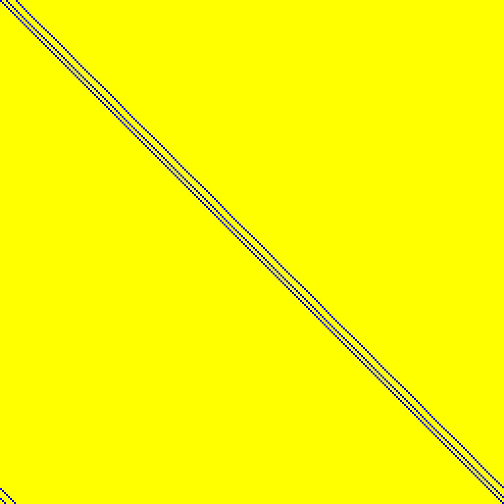

# Matrices in size 257

Source data: [`257bit.yaml`](257bit.yaml).

Entry count: 1.

| Key | Preview | Shape | Year | Properties | Origin |
|:----|:-------:|:-----:|:----:|:-----------|:-------|
| **SUBTERRANEAN.THETA** Subterranean, θ |  | 257 x 257 | 2020 | - | [link](https://tosc.iacr.org/index.php/ToSC/article/view/8622) |

