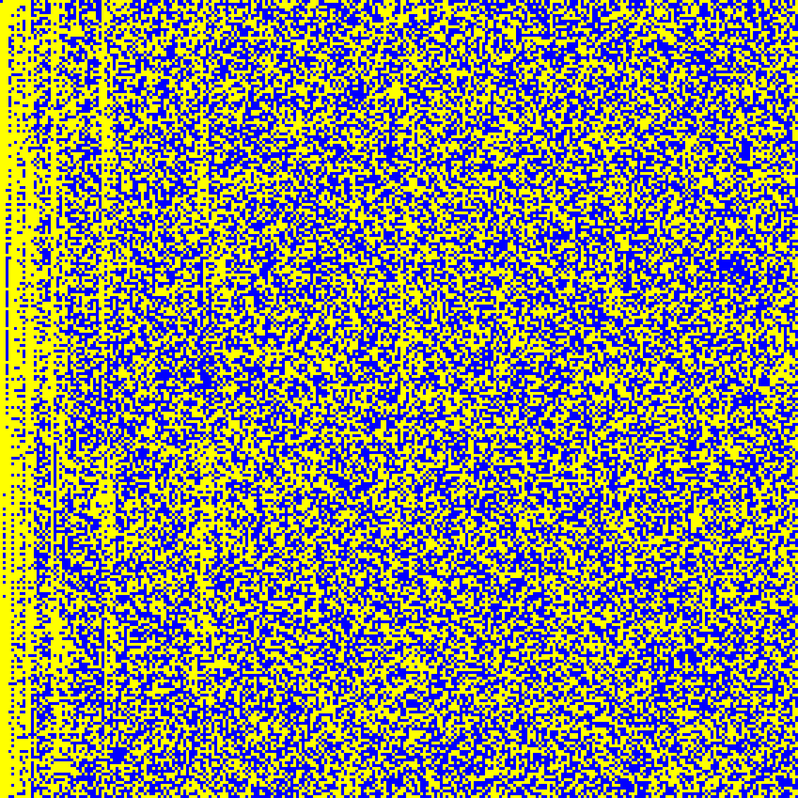
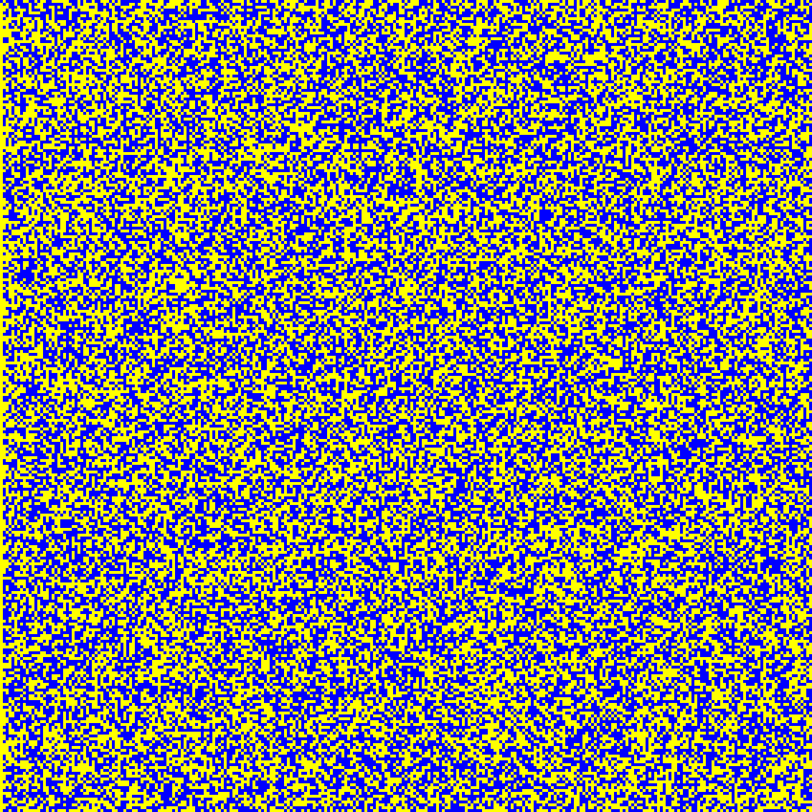
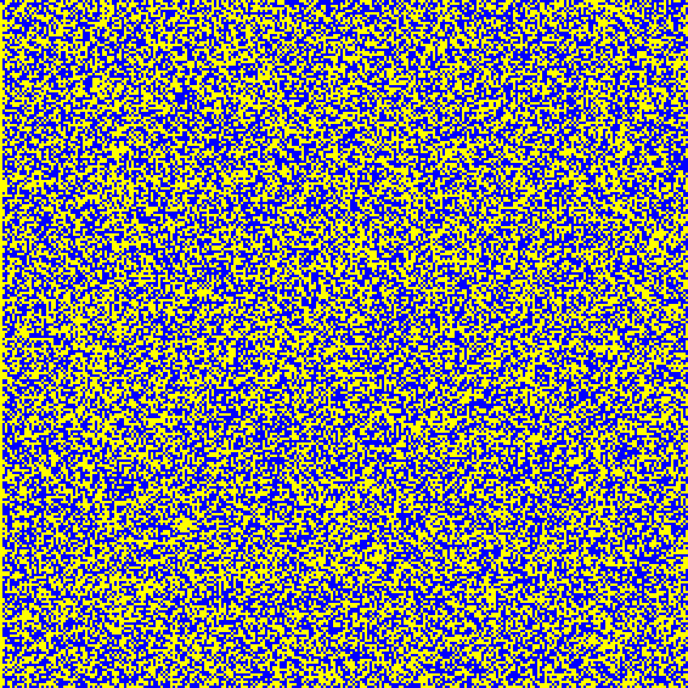
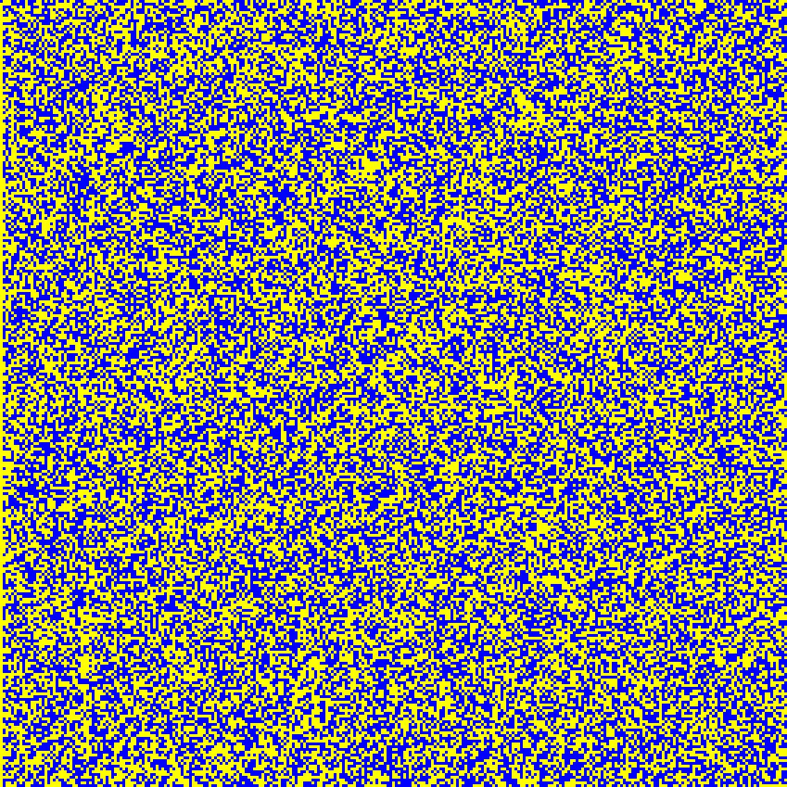
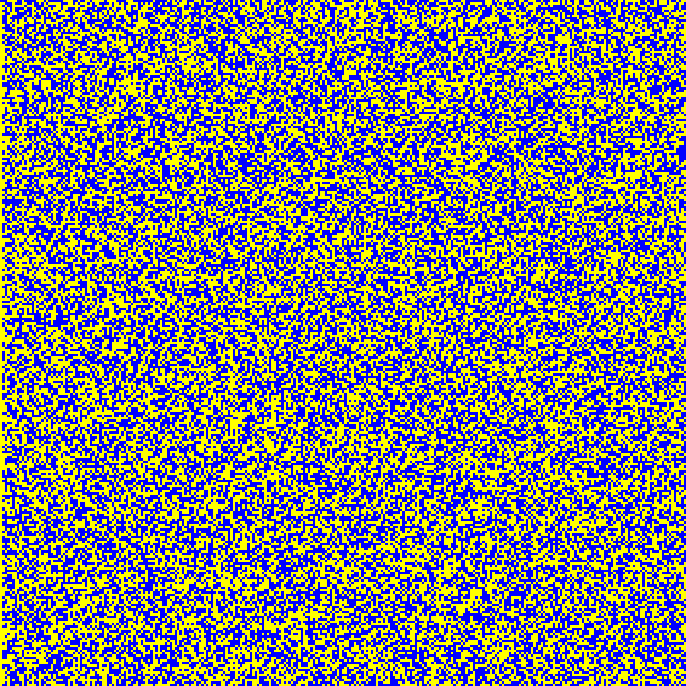
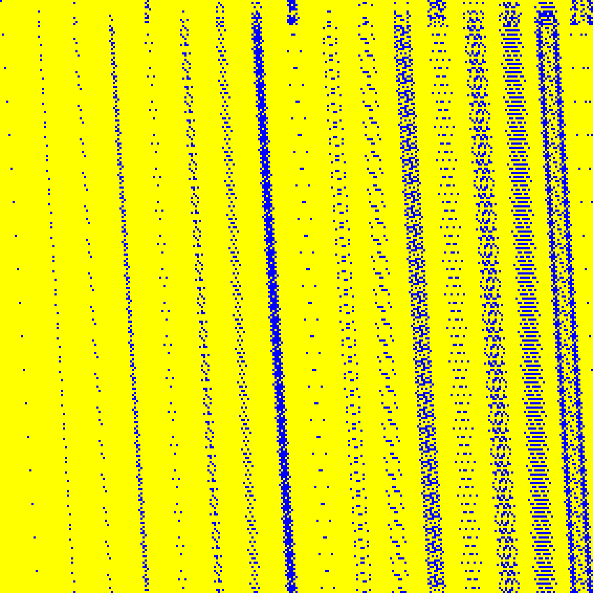
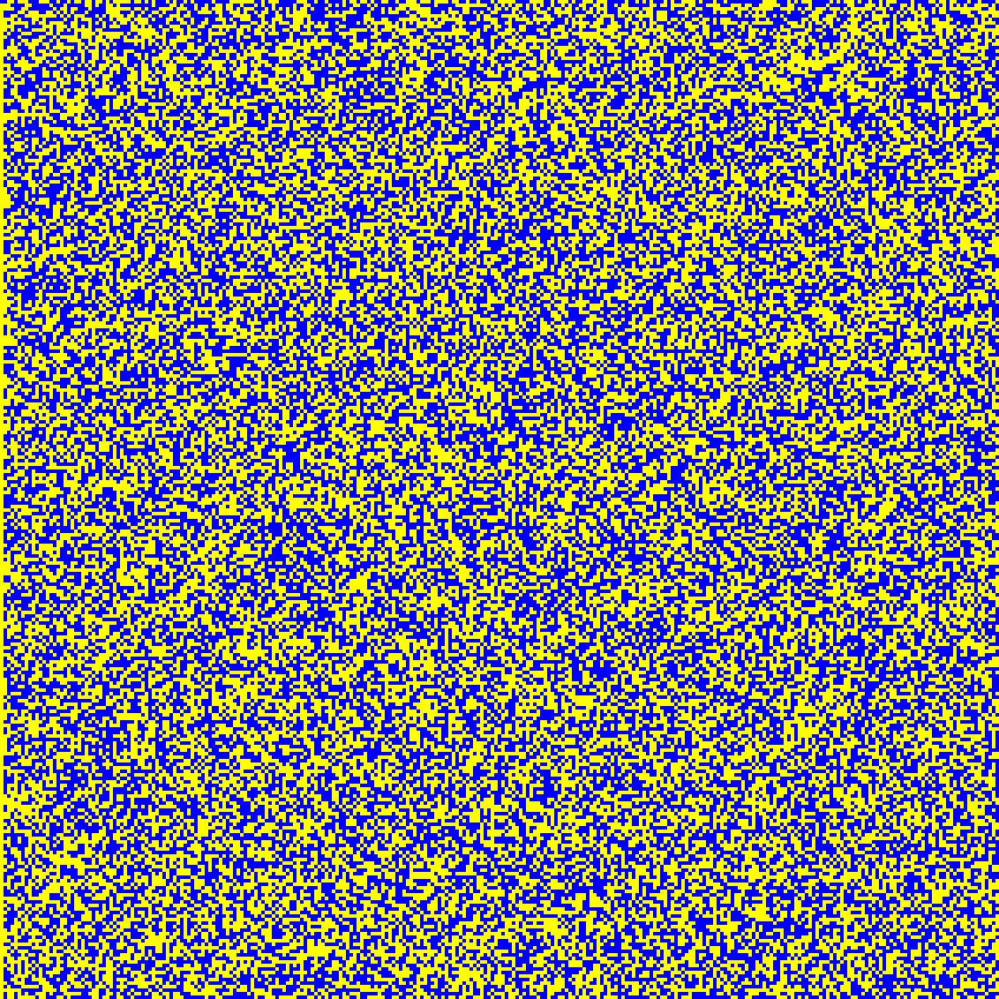
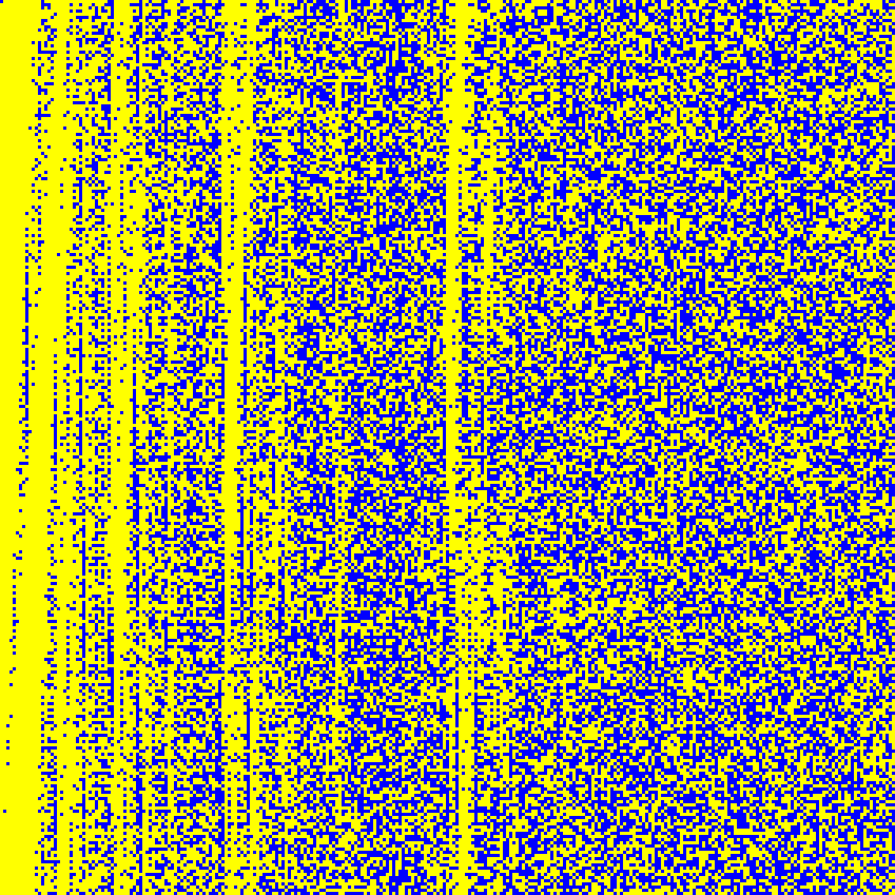

# Matrices in size 283

Source data: [`283bit.part01.yaml`](283bit.part01.yaml), [`283bit.part02.yaml`](283bit.part02.yaml), [`283bit.part03.yaml`](283bit.part03.yaml).

The band is published as several parts so that every file renders on GitHub; `bigfatmatrix.py` merges them back into one entry per key.

Entry count: 11.

| Key | Preview | Shape | Year | Properties | Origin |
|:----|:-------:|:-----:|:----:|:-----------|:-------|
| **GF283.ECCSQR** GF(2²⁸³), squaring also known as `GF283.ECCSQR` |  | 283 x 283 | 2000, 2013 | order = 283 | [link](https://nvlpubs.nist.gov/nistpubs/FIPS/NIST.FIPS.186-4.pdf) |
| **GF283.SQR** GF(2²⁸³), squaring also known as `GF283.ECCSQR` |  | 283 x 283 | 2000, 2013 | order = 283 | [link](https://nvlpubs.nist.gov/nistpubs/FIPS/NIST.FIPS.186-4.pdf) |
| **GF283.SQR10** GF(2²⁸³), Matrix_2_10 |  | 283 x 283 | 2025 | order = 283 | [link](https://github.com/starj1023/Binary_ECC) |
| **GF283.SQR128** GF(2²⁸³), Matrix_2_128 |  | 283 x 283 | 2025 | order = 283 | [link](https://github.com/starj1023/Binary_ECC) |
| **GF283.SQR16** GF(2²⁸³), Matrix_2_16 also known as `GF_283_ECC_SQR` |  | 283 x 283 | 2025 | order = 283 | [link](https://github.com/starj1023/Binary_ECC) |
| **GF283.SQR2** GF(2²⁸³), Matrix_2_2 |  | 283 x 283 | 2025 | order = 283 | [link](https://github.com/starj1023/Binary_ECC) |
| **GF283.SQR26** GF(2²⁸³), Matrix_2_26 |  | 283 x 283 | 2025 | order = 283 | [link](https://github.com/starj1023/Binary_ECC) |
| **GF283.SQR32** GF(2²⁸³), Matrix_2_32 |  | 283 x 283 | 2025 | order = 283 | [link](https://github.com/starj1023/Binary_ECC) |
| **GF283.SQR4** GF(2²⁸³), Matrix_2_4 |  | 283 x 283 | 2025 | order = 283 | [link](https://github.com/starj1023/Binary_ECC) |
| **GF283.SQR64** GF(2²⁸³), Matrix_2_64 |  | 283 x 283 | 2025 | order = 283 | [link](https://github.com/starj1023/Binary_ECC) |
| **GF283.SQR8** GF(2²⁸³), Matrix_2_8 |  | 283 x 283 | 2025 | order = 283 | [link](https://github.com/starj1023/Binary_ECC) |

