# Matrices in size band 17 to 32

Source data: [`32bit.yaml`](32bit.yaml).

Entry count: 83.

| Key | Preview | Shape | Year | Properties | Origin |
|:----|:-------:|:-----:|:----:|:-----------|:-------|
| **AES.MIXCOLUMN** AES, MixColumn | 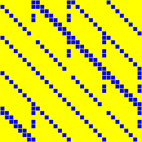 | 32 x 32 | 1998, 2001 | order = 4 | [link](https://csrc.nist.gov/projects/cryptographic-standards-and-guidelines/archived-crypto-projects/aes-development) |
| **ANUBIS.H** Anubis, H also known as `ANUBIS` |  | 32 x 32 | 2000 | involution, order = 2 | [link](https://www.cosic.esat.kuleuven.be/nessie/) |
| **ARADI.L0** ARADI, L₀ | 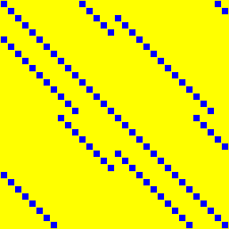 | 32 x 32 | 2024 | involution, order = 2 | [link](https://eprint.iacr.org/2024/1240) |
| **ARADI.L1** ARADI, L₁ | 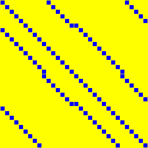 | 32 x 32 | 2024 | involution, order = 2 | [link](https://eprint.iacr.org/2024/1240) |
| **ARADI.L2** ARADI, L₂ |  | 32 x 32 | 2024 | involution, order = 2 | [link](https://eprint.iacr.org/2024/1240) |
| **ARADI.L3** ARADI, L₃ | 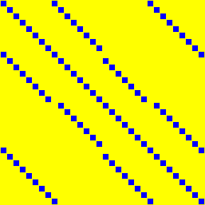 | 32 x 32 | 2024 | involution, symmetric, order = 2 | [link](https://eprint.iacr.org/2024/1240) |
| **BKL16.S32** Beierle-Kranz-Leander, 4 × 4 over GF(2⁸) | 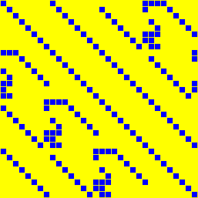 | 32 x 32 | 2016 | order = 340 | [link](https://eprint.iacr.org/2016/119) |
| **CHAM.KS1** CHAM, key schedule, variant 1 | 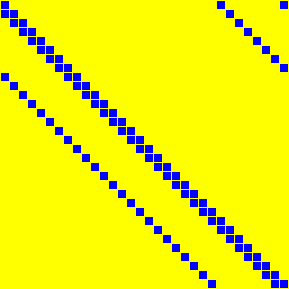 | 32 x 32 | 2017 | order = 32 | [link](https://link.springer.com/chapter/10.1007/978-3-319-78556-1_1) |
| **CHAM.KS2** CHAM, key schedule, variant 2 | 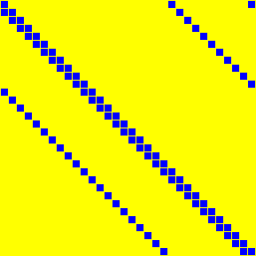 | 32 x 32 | 2017 | order = 16 | [link](https://link.springer.com/chapter/10.1007/978-3-319-78556-1_1) |
| **CHILOW.L32** ChiLow, L₃₂ | 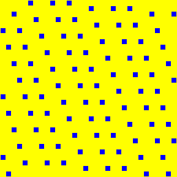 | 32 x 32 | 2025 | order = 16 | [link](https://doi.org/10.1007/978-3-031-91104-9) |
| **CLEFIA.M0** Anubis, H also known as `ANUBIS` | 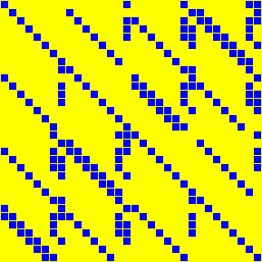 | 32 x 32 | 2000 | involution, order = 2 | [link](https://www.cosic.esat.kuleuven.be/nessie/) |
| **CLEFIA.M1** CLEFIA, M₁ | 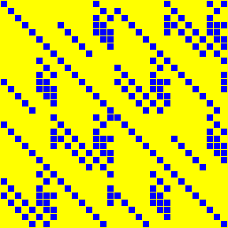 | 32 x 32 | 2007 | involution, order = 2 | [link](https://www.sony.net/Products/cryptography/clefia/) |
| **DIALGA** Dialga, MatrixMul | 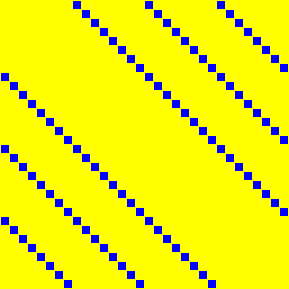 | 32 x 32 | 2025 | involution, symmetric, order = 2 | [link](https://tosc.iacr.org/index.php/ToSC) |
| **DL18.F16A8** Duval-Leurent, M⁹,⁵₄,₃ | 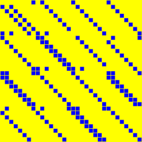 | 32 x 32 | 2018 | order = 2730 | [link](https://tosc.iacr.org/index.php/ToSC/article/view/888) |
| **DL18.F8A8** Duval-Leurent, M⁸,³₄,₆ | 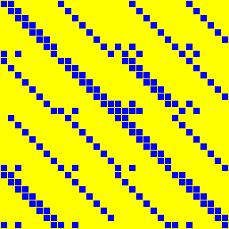 | 32 x 32 | 2018 | order = 120 | [link](https://tosc.iacr.org/index.php/ToSC/article/view/888) |
| **FOX.MU4** FOX, μ₄ | 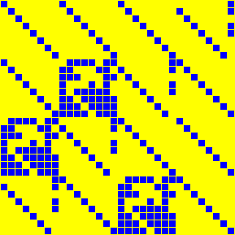 | 32 x 32 | 2003 | order = 65535 | [link](https://link.springer.com/chapter/10.1007/978-3-540-30564-4_8) |
| **GF32.SQR** GF(2³²), squaring | 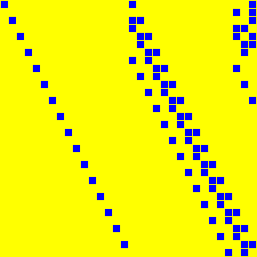 | 32 x 32 | 1998 | order = 32 | [link](https://www.hpl.hp.com/techreports/98/HPL-98-135.pdf) |
| **ICEPOLE.SLICE** ICEPOLE, slice mixer | 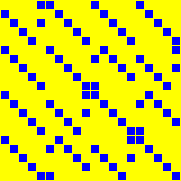 | 20 x 20 | 2014, 2020 | order = 1023 | [link](https://eprint.iacr.org/2020/1296) |
| **JPST17.IS32** Jean-Peyrin-Sim-Tourteaux, M₄,ᵢ,₈ | 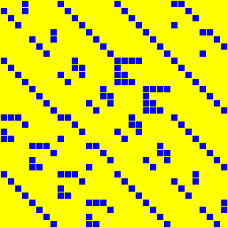 | 32 x 32 | 2017 | involution, order = 2 | [link](https://eprint.iacr.org/2017/101) |
| **JPST17.S32** Jean-Peyrin-Sim-Tourteaux, 4 × 4 over GF(2⁸) | 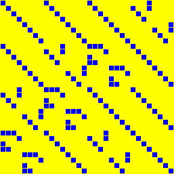 | 32 x 32 | 2017 | order = 4095 | [link](https://eprint.iacr.org/2017/101) |
| **KECCAK.25** Keccak-f[25], θ | 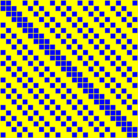 | 25 x 25 | 2015 | symmetric, order = 3 | [link](https://nvlpubs.nist.gov/nistpubs/FIPS/NIST.FIPS.202.pdf) |
| **KLSW17.ANUBIS** Kranz-Leander-Stoffelen-Wiemer, Anubis | 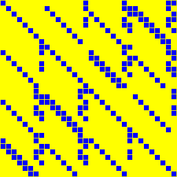 | 32 x 32 | 2017 | involution, order = 2 | [link](https://doi.org/10.46586/tosc.v2017.i4.188-211) |
| **KLSW17.IS32** Kranz-Leander-Stoffelen-Wiemer, M⁻¹, 4 × 4 over GF(2⁸) | 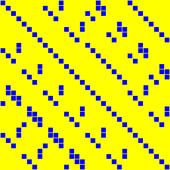 | 32 x 32 | 2017 | involution, order = 2 | [link](https://tosc.iacr.org/index.php/ToSC/article/view/805) |
| **KLSW17.IS8GF4** Kranz-Leander-Stoffelen-Wiemer, M⁻¹, 8 × 8 over GF(2⁴) | 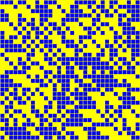 | 32 x 32 | 2017 | involution, order = 2 | [link](https://tosc.iacr.org/index.php/ToSC/article/view/805) |
| **KLSW17.S32** Kranz-Leander-Stoffelen-Wiemer, M, 4 × 4 over GF(2⁸) | 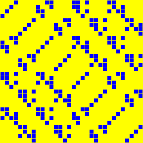 | 32 x 32 | 2017 | order = 12 | [link](https://tosc.iacr.org/index.php/ToSC/article/view/805) |
| **KLSW17.S8GF4** Kranz-Leander-Stoffelen-Wiemer, M, 8 × 8 over GF(2⁴) | 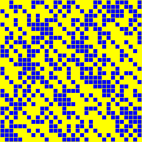 | 32 x 32 | 2017 | order = 131070 | [link](https://tosc.iacr.org/index.php/ToSC/article/view/805) |
| **LS16.S32** Liu-Sim, 4 × 4 over GF(2⁸) | 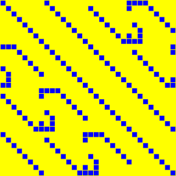 | 32 x 32 | 2016 | order = 20 | [link](https://tosc.iacr.org/index.php/ToSC) |
| **LSL19.W148** Li-Sun-Li-Wei-Hu, involutory 4 × 4, weight 148 | 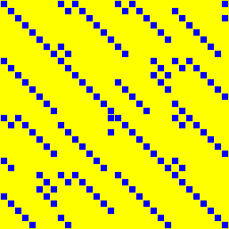 | 32 x 32 | 2019 | involution, order = 2 | [link](https://doi.org/10.46586/tosc.v2019.i1.84-117) |
| **LSL19.W149** Li-Sun-Li-Wei-Hu, involutory 4 × 4, weight 149 | 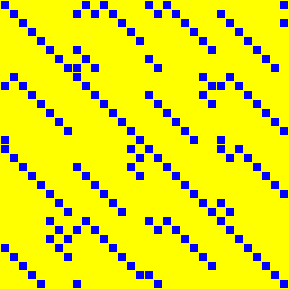 | 32 x 32 | 2019 | involution, order = 2 | [link](https://doi.org/10.46586/tosc.v2019.i1.84-117) |
| **LSL19.W150** Li-Sun-Li-Wei-Hu, involutory 4 × 4, weight 150 | 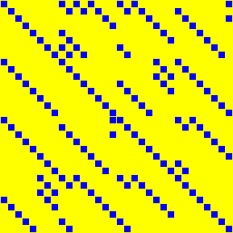 | 32 x 32 | 2019 | involution, order = 2 | [link](https://doi.org/10.46586/tosc.v2019.i1.84-117) |
| **LSL19.W151** Li-Sun-Li-Wei-Hu, involutory 4 × 4, weight 151 | 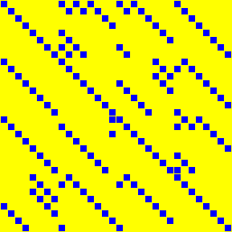 | 32 x 32 | 2019 | involution, order = 2 | [link](https://doi.org/10.46586/tosc.v2019.i1.84-117) |
| **LSL19.W152** Li-Sun-Li-Wei-Hu, involutory 4 × 4, weight 152 | 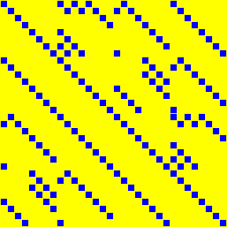 | 32 x 32 | 2019 | involution, order = 2 | [link](https://doi.org/10.46586/tosc.v2019.i1.84-117) |
| **LSL19.W153** Li-Sun-Li-Wei-Hu, involutory 4 × 4, weight 153 | 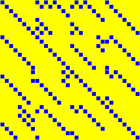 | 32 x 32 | 2019 | involution, order = 2 | [link](https://doi.org/10.46586/tosc.v2019.i1.84-117) |
| **LSL19.W154** Li-Sun-Li-Wei-Hu, involutory 4 × 4, weight 154 | 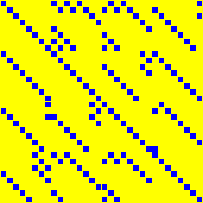 | 32 x 32 | 2019 | involution, order = 2 | [link](https://doi.org/10.46586/tosc.v2019.i1.84-117) |
| **LSL19.W155** Li-Sun-Li-Wei-Hu, involutory 4 × 4, weight 155 | 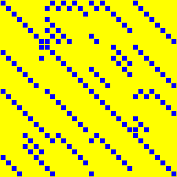 | 32 x 32 | 2019 | involution, order = 2 | [link](https://doi.org/10.46586/tosc.v2019.i1.84-117) |
| **LSL19.W156** Li-Sun-Li-Wei-Hu, involutory 4 × 4, weight 156 | 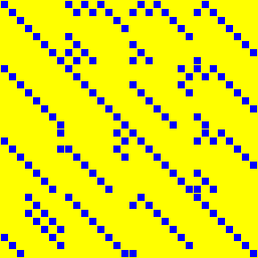 | 32 x 32 | 2019 | involution, order = 2 | [link](https://doi.org/10.46586/tosc.v2019.i1.84-117) |
| **LSL19.W157** Li-Sun-Li-Wei-Hu, involutory 4 × 4, weight 157 | 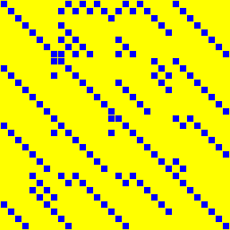 | 32 x 32 | 2019 | involution, order = 2 | [link](https://doi.org/10.46586/tosc.v2019.i1.84-117) |
| **LSL19.W158** Li-Sun-Li-Wei-Hu, involutory 4 × 4, weight 158 | 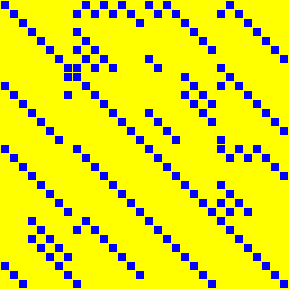 | 32 x 32 | 2019 | involution, order = 2 | [link](https://doi.org/10.46586/tosc.v2019.i1.84-117) |
| **LSL19.W160** Li-Sun-Li-Wei-Hu, involutory 4 × 4, weight 160 | 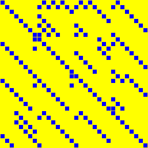 | 32 x 32 | 2019 | involution, order = 2 | [link](https://doi.org/10.46586/tosc.v2019.i1.84-117) |
| **LSL19.W161** Li-Sun-Li-Wei-Hu, involutory 4 × 4, weight 161 | 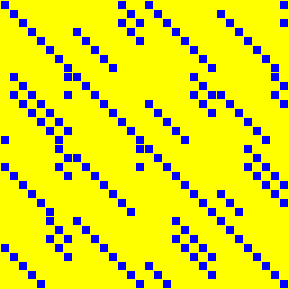 | 32 x 32 | 2019 | involution, order = 2 | [link](https://doi.org/10.46586/tosc.v2019.i1.84-117) |
| **LSL19.W162** Li-Sun-Li-Wei-Hu, involutory 4 × 4, weight 162 | 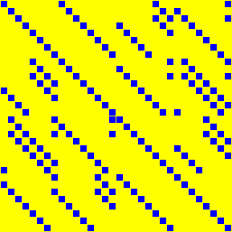 | 32 x 32 | 2019 | involution, order = 2 | [link](https://doi.org/10.46586/tosc.v2019.i1.84-117) |
| **LSL19.W163** Li-Sun-Li-Wei-Hu, involutory 4 × 4, weight 163 | 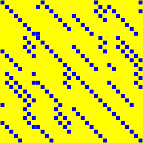 | 32 x 32 | 2019 | involution, order = 2 | [link](https://doi.org/10.46586/tosc.v2019.i1.84-117) |
| **LSL19.W164** Li-Sun-Li-Wei-Hu, involutory 4 × 4, weight 164 | 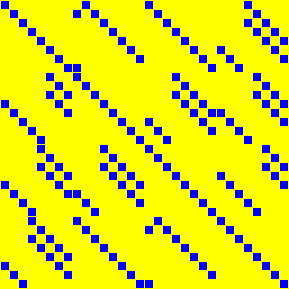 | 32 x 32 | 2019 | involution, order = 2 | [link](https://doi.org/10.46586/tosc.v2019.i1.84-117) |
| **LSL19.W165** Li-Sun-Li-Wei-Hu, involutory 4 × 4, weight 165 | 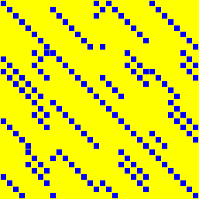 | 32 x 32 | 2019 | involution, order = 2 | [link](https://doi.org/10.46586/tosc.v2019.i1.84-117) |
| **LSL19.W166** Li-Sun-Li-Wei-Hu, involutory 4 × 4, weight 166 | 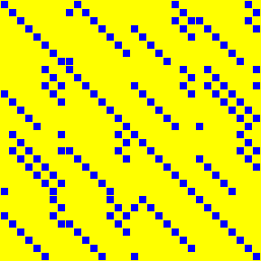 | 32 x 32 | 2019 | involution, order = 2 | [link](https://doi.org/10.46586/tosc.v2019.i1.84-117) |
| **LSL19.W167** Li-Sun-Li-Wei-Hu, involutory 4 × 4, weight 167 | 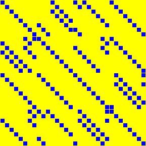 | 32 x 32 | 2019 | involution, order = 2 | [link](https://doi.org/10.46586/tosc.v2019.i1.84-117) |
| **LSL19.W168** Li-Sun-Li-Wei-Hu, involutory 4 × 4, weight 168 | 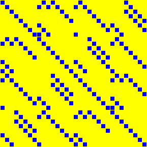 | 32 x 32 | 2019 | involution, order = 2 | [link](https://doi.org/10.46586/tosc.v2019.i1.84-117) |
| **LSL19.W169** Li-Sun-Li-Wei-Hu, involutory 4 × 4, weight 169 | 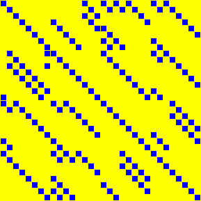 | 32 x 32 | 2019 | involution, order = 2 | [link](https://doi.org/10.46586/tosc.v2019.i1.84-117) |
| **LSL19.W170** Li-Sun-Li-Wei-Hu, involutory 4 × 4, weight 170 | 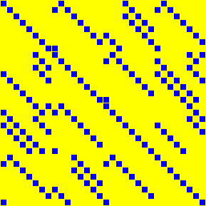 | 32 x 32 | 2019 | involution, order = 2 | [link](https://doi.org/10.46586/tosc.v2019.i1.84-117) |
| **LSL19.W171** Li-Sun-Li-Wei-Hu, involutory 4 × 4, weight 171 | 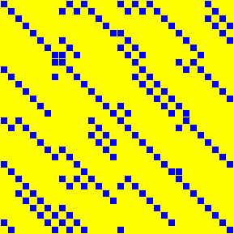 | 32 x 32 | 2019 | involution, order = 2 | [link](https://doi.org/10.46586/tosc.v2019.i1.84-117) |
| **LSL19.W172** Li-Sun-Li-Wei-Hu, involutory 4 × 4, weight 172 | 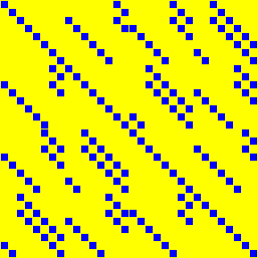 | 32 x 32 | 2019 | involution, order = 2 | [link](https://doi.org/10.46586/tosc.v2019.i1.84-117) |
| **LW16.A32** Li-Wang, 4 × 4 over GF(2⁸), variant A | 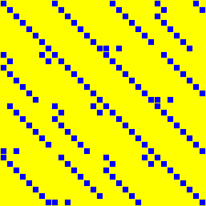 | 32 x 32 | 2016 | order = 20 | [link](https://tosc.iacr.org/index.php/ToSC) |
| **LW16.B32** Li-Wang, 4 × 4 over GF(2⁸), variant B |  | 32 x 32 | 2016 | order = 510 | [link](https://tosc.iacr.org/index.php/ToSC) |
| **LW16.IA32** Li-Wang, involutory 4 × 4 over GF(2⁸), variant A |  | 32 x 32 | 2016 | involution, order = 2 | [link](https://tosc.iacr.org/index.php/ToSC) |
| **LW16.IB32** Li-Wang, involutory 4 × 4 over GF(2⁸), variant B |  | 32 x 32 | 2016 | involution, order = 2 | [link](https://tosc.iacr.org/index.php/ToSC) |
| **PHOTON.P100** PHOTON, P₁₀₀ |  | 20 x 20 | 2011 | order = 3 | [link](https://doi.org/10.1007/978-3-642-22792-9_13) |
| **PHOTON.P144** PHOTON, P₁₄₄ |  | 24 x 24 | 2011 | order = 17 | [link](https://doi.org/10.1007/978-3-642-22792-9_13) |
| **PHOTON.P196** PHOTON, P₁₉₆ |  | 28 x 28 | 2011 | order = 15 | [link](https://doi.org/10.1007/978-3-642-22792-9_13) |
| **PHOTON.P256** PHOTON, P₂₅₆ |  | 32 x 32 | 2011 | order = 255 | [link](https://doi.org/10.1007/978-3-642-22792-9_13) |
| **PYJAMASK.M0** Pyjamask, M₀ |  | 32 x 32 | 2019 | order = 32 | [link](https://csrc.nist.gov/projects/lightweight-cryptography) |
| **PYJAMASK.M1** Pyjamask, M₁ |  | 32 x 32 | 2019 | order = 32 | [link](https://csrc.nist.gov/projects/lightweight-cryptography) |
| **PYJAMASK.M2** Pyjamask, M₂ |  | 32 x 32 | 2019 | order = 32 | [link](https://csrc.nist.gov/projects/lightweight-cryptography) |
| **PYJAMASK.M3** Pyjamask, M₃ |  | 32 x 32 | 2019 | order = 16 | [link](https://csrc.nist.gov/projects/lightweight-cryptography) |
| **PYJAMASK.MK** Pyjamask, Mₖ |  | 32 x 32 | 2019 | order = 32 | [link](https://csrc.nist.gov/projects/lightweight-cryptography) |
| **QARMA.S128** QARMA, QARMA-128 M |  | 32 x 32 | 2017 | involution, order = 2 | [link](https://eprint.iacr.org/2016/444) |
| **SHA256.BIGSIGMA0** SHA-256, Σ₀ also known as `SHA2.BIGSIGMA0` |  | 32 x 32 | 2015 | order = 32 | [link](https://nvlpubs.nist.gov/nistpubs/FIPS/NIST.FIPS.180-4.pdf) |
| **SHA256.BIGSIGMA1** SHA-256, Σ₁ also known as `SHA2.BIGSIGMA1` |  | 32 x 32 | 2015 | order = 16 | [link](https://nvlpubs.nist.gov/nistpubs/FIPS/NIST.FIPS.180-4.pdf) |
| **SHA256.SMALLSIGMA0** SHA-256, σ₀ also known as `SHA2.SMALLSIGMA0` |  | 32 x 32 | 2015 | order = 49146 | [link](https://nvlpubs.nist.gov/nistpubs/FIPS/NIST.FIPS.180-4.pdf) |
| **SHA256.SMALLSIGMA1** SHA-256, σ₁ also known as `SHA2.SMALLSIGMA1` |  | 32 x 32 | 2015 | order = 65534 | [link](https://nvlpubs.nist.gov/nistpubs/FIPS/NIST.FIPS.180-4.pdf) |
| **SKOP15.IS4GF8** Sim-Khoo-Oggier-Peyrin, involutory 4 × 4 over GF(2⁸) |  | 32 x 32 | 2015 | involution, order = 2 | [link](https://tosc.iacr.org/) |
| **SKOP15.IS8GF4** Sim-Khoo-Oggier-Peyrin, involutory 8 × 8 over GF(2⁴) also known as `FSE_SKOP15_i_8x8_4` |  | 32 x 32 | 2015 | involution, order = 2 | [link](https://tosc.iacr.org/) |
| **SKOP15.S4GF8** Sim-Khoo-Oggier-Peyrin, 4 × 4 over GF(2⁸) |  | 32 x 32 | 2015 | order = 30 | [link](https://tosc.iacr.org/) |
| **SKOP15.S8GF4** Sim-Khoo-Oggier-Peyrin, 8 × 8 over GF(2⁴) also known as `FSE_SKOP15_8x8_4` |  | 32 x 32 | 2015 | order = 10 | [link](https://tosc.iacr.org/) |
| **SM4.L** SM4, L also known as `SM4` |  | 32 x 32 | 2003, 2007 | order = 16 | [link](https://datatracker.ietf.org/doc/html/rfc8998) |
| **SPEEDY.MC** SPEEDY, MixColumns |  | 32 x 32 | 2021 | order = 32 | [link](https://tches.iacr.org/index.php/TCHES/article/view/9074) |
| **SS16.IS32** Sarkar-Syed, involutory 4 × 4 over GF(2⁸) also known as `ToSC_SarSye16_4x4` |  | 32 x 32 | 2016 | involution, order = 2 | [link](https://tosc.iacr.org/index.php/ToSC/article/view/537) |
| **SS16.S32** Sarkar-Syed, 4 × 4 over GF(2⁸) also known as `ToSC_SarSye16_4x4` |  | 32 x 32 | 2016 | order = 340 | [link](https://tosc.iacr.org/index.php/ToSC/article/view/537) |
| **SS17.S32** Sarkar-Syed, 8 × 8 over GF(2⁴) |  | 32 x 32 | 2017 | order = 2730 | [link](https://eprint.iacr.org/2017/368) |
| **TWOFISH.MDS** Twofish, MDS also known as `TWOFISH` |  | 32 x 32 | 1998 | order = 1431655765 | [link](https://www.schneier.com/academic/twofish/) |
| **WHIRLWIND.M0** Whirlwind, M₀ |  | 32 x 32 | 2010 | order = 30 | [link](https://link.springer.com/chapter/10.1007/978-3-642-13858-4_5) |
| **WHIRLWIND.M1** Whirlwind, M₁ |  | 32 x 32 | 2010 | order = 30 | [link](https://link.springer.com/chapter/10.1007/978-3-642-13858-4_5) |
| **ZUC.L1** SM4, L also known as `SM4` |  | 32 x 32 | 2003, 2007 | order = 16 | [link](https://datatracker.ietf.org/doc/html/rfc8998) |
| **ZUC.L2** ZUC, L₂ |  | 32 x 32 | 2011 | order = 16 | [link](https://www.gsma.com/aboutus/wp-content/uploads/2014/12/eea3eia3zucv16.pdf) |

