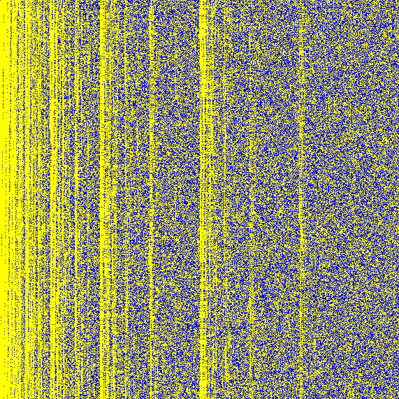
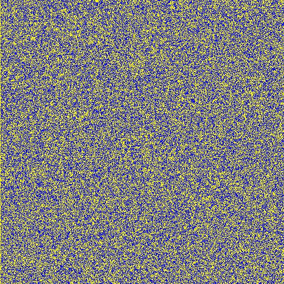
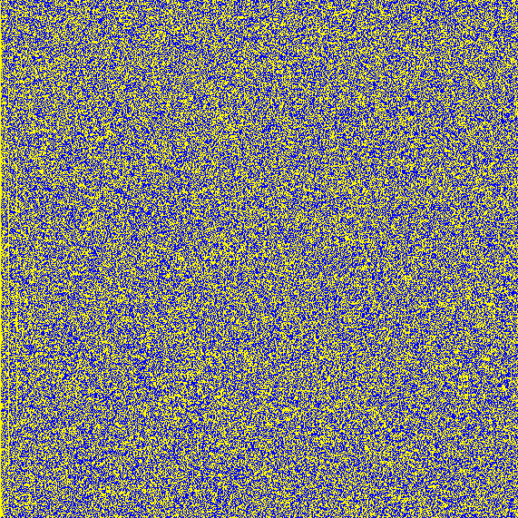
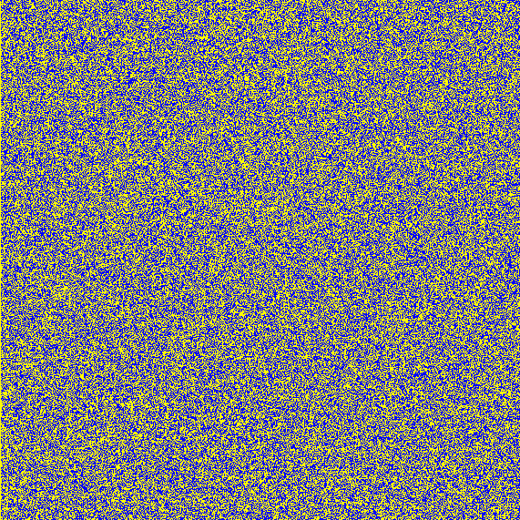
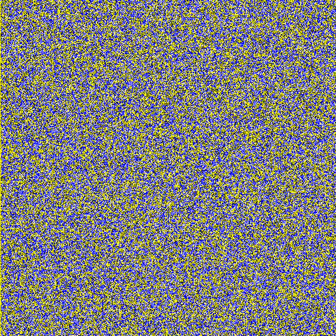
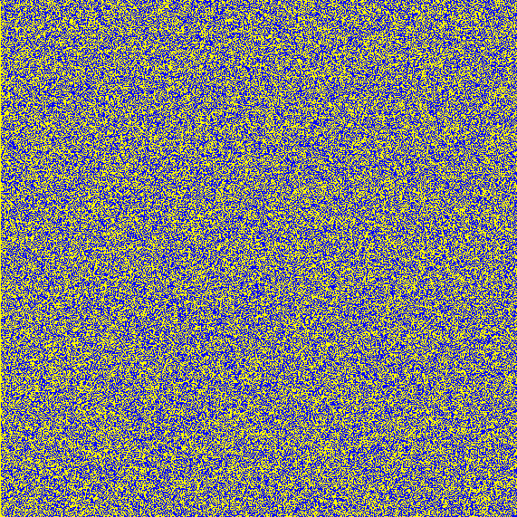
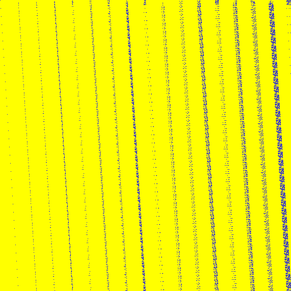
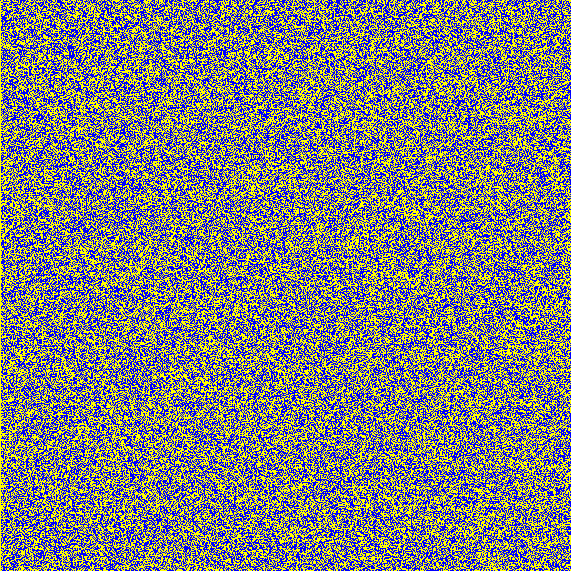
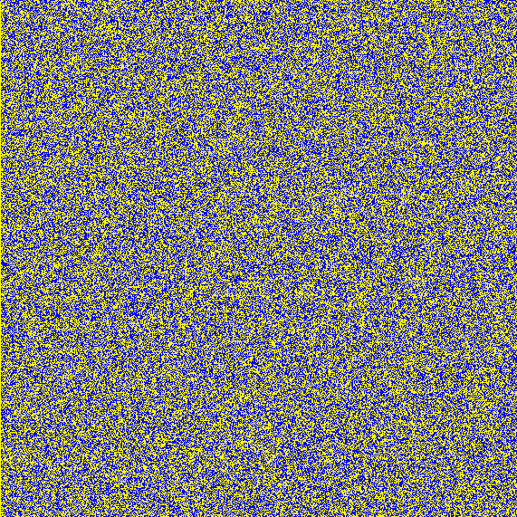
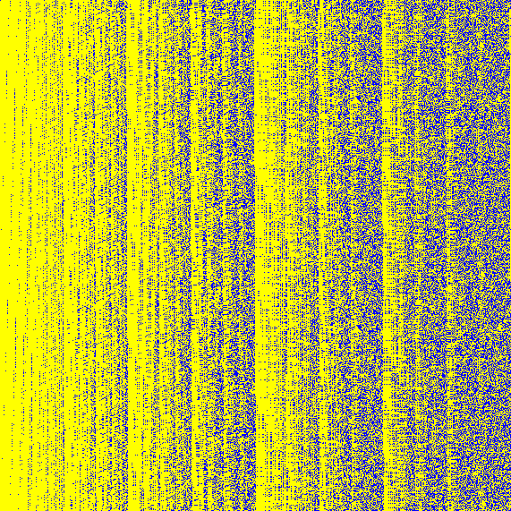

# Matrices in size 571

Source data: [`571bit.part01.yaml`](571bit.part01.yaml), [`571bit.part02.yaml`](571bit.part02.yaml), [`571bit.part03.yaml`](571bit.part03.yaml), [`571bit.part04.yaml`](571bit.part04.yaml), [`571bit.part05.yaml`](571bit.part05.yaml), [`571bit.part06.yaml`](571bit.part06.yaml), [`571bit.part07.yaml`](571bit.part07.yaml), [`571bit.part08.yaml`](571bit.part08.yaml), [`571bit.part09.yaml`](571bit.part09.yaml), [`571bit.part10.yaml`](571bit.part10.yaml), [`571bit.part11.yaml`](571bit.part11.yaml), [`571bit.part12.yaml`](571bit.part12.yaml).

The band is published as several parts so that every file renders on GitHub; `bigfatmatrix.py` merges them back into one entry per key.

Entry count: 13.

| Key | Preview | Shape | Year | Properties | Origin |
|:----|:-------:|:-----:|:----:|:-----------|:-------|
| **GF571.ECCSQR** GF(2⁵⁷¹), squaring also known as `GF571.ECCSQR` |  | 571 x 571 | 2000, 2013 | - | [link](https://nvlpubs.nist.gov/nistpubs/FIPS/NIST.FIPS.186-4.pdf) |
| **GF571.SQR** GF(2⁵⁷¹), squaring also known as `GF571.ECCSQR` |  | 571 x 571 | 2000, 2013 | - | [link](https://nvlpubs.nist.gov/nistpubs/FIPS/NIST.FIPS.186-4.pdf) |
| **GF571.SQR10** GF(2⁵⁷¹), Matrix_2_10 |  | 571 x 571 | 2025 | - | [link](https://github.com/starj1023/Binary_ECC) |
| **GF571.SQR128** GF(2⁵⁷¹), Matrix_2_128 |  | 571 x 571 | 2025 | - | [link](https://github.com/starj1023/Binary_ECC) |
| **GF571.SQR16** GF(2⁵⁷¹), Matrix_2_16 also known as `GF_571_ECC_SQR` |  | 571 x 571 | 2025 | - | [link](https://github.com/starj1023/Binary_ECC) |
| **GF571.SQR2** GF(2⁵⁷¹), Matrix_2_2 |  | 571 x 571 | 2025 | - | [link](https://github.com/starj1023/Binary_ECC) |
| **GF571.SQR256** GF(2⁵⁷¹), Matrix_2_256 |  | 571 x 571 | 2025 | - | [link](https://github.com/starj1023/Binary_ECC) |
| **GF571.SQR26** GF(2⁵⁷¹), Matrix_2_26 |  | 571 x 571 | 2025 | - | [link](https://github.com/starj1023/Binary_ECC) |
| **GF571.SQR32** GF(2⁵⁷¹), Matrix_2_32 |  | 571 x 571 | 2025 | - | [link](https://github.com/starj1023/Binary_ECC) |
| **GF571.SQR4** GF(2⁵⁷¹), Matrix_2_4 |  | 571 x 571 | 2025 | - | [link](https://github.com/starj1023/Binary_ECC) |
| **GF571.SQR58** GF(2⁵⁷¹), Matrix_2_58 |  | 571 x 571 | 2025 | - | [link](https://github.com/starj1023/Binary_ECC) |
| **GF571.SQR64** GF(2⁵⁷¹), Matrix_2_64 |  | 571 x 571 | 2025 | - | [link](https://github.com/starj1023/Binary_ECC) |
| **GF571.SQR8** GF(2⁵⁷¹), Matrix_2_8 |  | 571 x 571 | 2025 | - | [link](https://github.com/starj1023/Binary_ECC) |

