# Matrices in size band 33 to 64

Source data: [`64bit.part01.yaml`](64bit.part01.yaml), [`64bit.part02.yaml`](64bit.part02.yaml), [`64bit.part03.yaml`](64bit.part03.yaml).

The band is published as several parts so that every file renders on GitHub; `bigfatmatrix.py` merges them back into one entry per key.

Entry count: 163.

| Key | Preview | Shape | Year | Properties | Origin |
|:----|:-------:|:-----:|:----:|:-----------|:-------|
| **ARADI.M0** ARADI, M₀ |  | 64 x 64 | 2024 | order = 48 | [link](https://eprint.iacr.org/2024/1240) |
| **ARADI.M1** ARADI, M₁ |  | 64 x 64 | 2024 | order = 96 | [link](https://eprint.iacr.org/2024/1240) |
| **ASCON.SIGMA0** Ascon, Σ₀ |  | 64 x 64 | 2014 | order = 64 | [link](https://ascon.iaik.tugraz.at/) |
| **ASCON.SIGMA1** Ascon, Σ₁ |  | 64 x 64 | 2014 | order = 32 | [link](https://ascon.iaik.tugraz.at/) |
| **ASCON.SIGMA2** Ascon, Σ₂ |  | 64 x 64 | 2014 | order = 64 | [link](https://ascon.iaik.tugraz.at/) |
| **ASCON.SIGMA3** Ascon, Σ₃ |  | 64 x 64 | 2014 | order = 64 | [link](https://ascon.iaik.tugraz.at/) |
| **ASCON.SIGMA4** Ascon, Σ₄ | 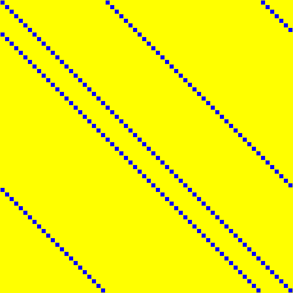 | 64 x 64 | 2014 | order = 32 | [link](https://ascon.iaik.tugraz.at/) |
| **BKL16.S64** Beierle-Kranz-Leander, 8 × 8 over GF(2⁸) | 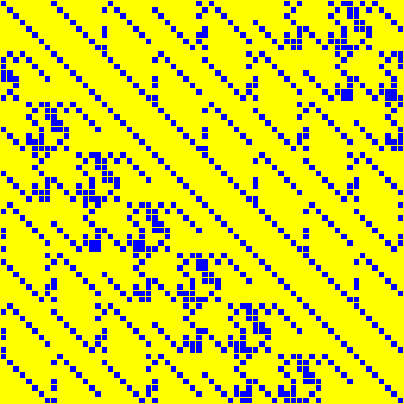 | 64 x 64 | 2016 | order = 2040 | [link](https://eprint.iacr.org/2016/119) |
| **CHILOW.L64** ChiLow, L₆₄ | 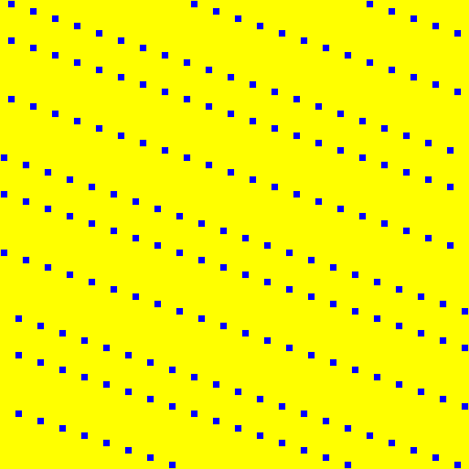 | 64 x 64 | 2025 | order = 32 | [link](https://doi.org/10.1007/978-3-031-91104-9) |
| **FOX.MU8** FOX, μ₈ | 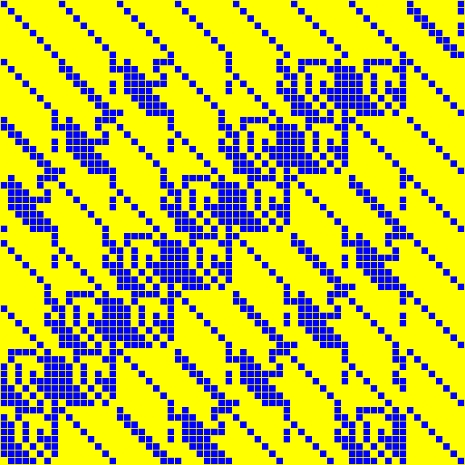 | 64 x 64 | 2003 | order = 56514897667635 | [link](https://link.springer.com/chapter/10.1007/978-3-540-30564-4_8) |
| **GF64.SQR** GF(2⁶⁴), squaring |  | 64 x 64 | 1998 | order = 64 | [link](https://www.hpl.hp.com/techreports/98/HPL-98-135.pdf) |
| **GROESTL.MIXBYTES** Grøstl, MixBytes also known as `GROESTL` | 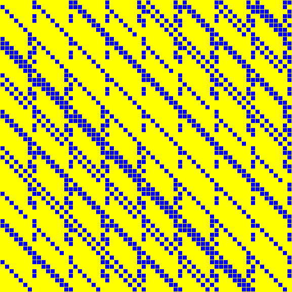 | 64 x 64 | 2008 | order = 2040 | [link](http://www.groestl.info/) |
| **HSWC26.C4GF10P409N1** Huang-Sun-Wu-Chen, Circ(1,1,0x081,0x080) modulo 0x409 | 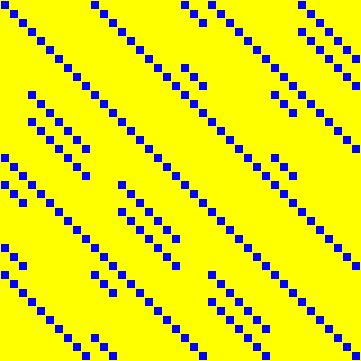 | 40 x 40 | 2026 | order = 4 | [link](https://eprint.iacr.org/2026/2520) |
| **HSWC26.C4GF10P409N2** Huang-Sun-Wu-Chen, Circ(1,1,0x008,0x020) modulo 0x409 | 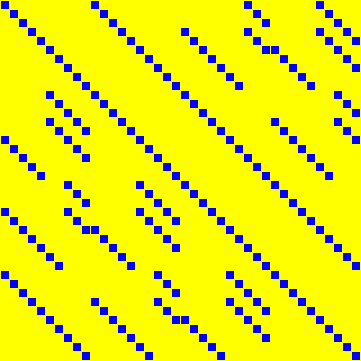 | 40 x 40 | 2026 | order = 4092 | [link](https://eprint.iacr.org/2026/2520) |
| **HSWC26.C4GF10P409N3** Huang-Sun-Wu-Chen, Circ(1,1,0x020,0x120) modulo 0x409 | 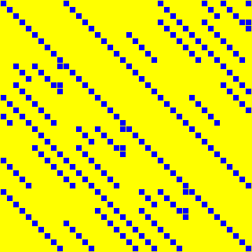 | 40 x 40 | 2026 | order = 4092 | [link](https://eprint.iacr.org/2026/2520) |
| **HSWC26.C4GF10P409N4** Huang-Sun-Wu-Chen, Circ(1,1,0x100,0x200) modulo 0x409 | 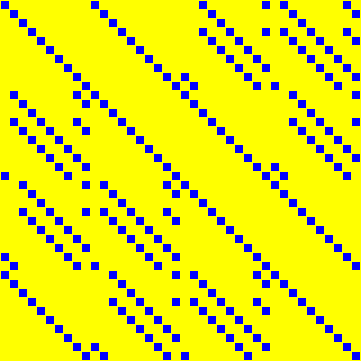 | 40 x 40 | 2026 | order = 4092 | [link](https://eprint.iacr.org/2026/2520) |
| **HSWC26.C4GF10P409N5** Huang-Sun-Wu-Chen, Circ(1,1,0x204,0x020) modulo 0x409 | 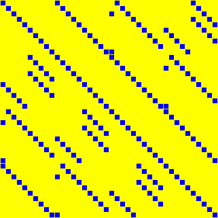 | 40 x 40 | 2026 | order = 4092 | [link](https://eprint.iacr.org/2026/2520) |
| **HSWC26.C4GF10P48BN1** Huang-Sun-Wu-Chen, Circ(1,1,0x245,0x244) modulo 0x48b | 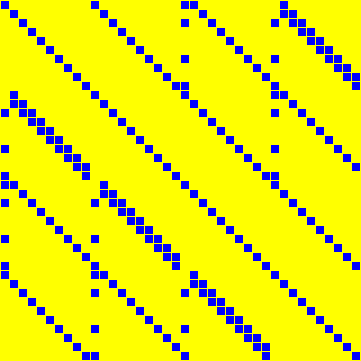 | 40 x 40 | 2026 | order = 4 | [link](https://eprint.iacr.org/2026/2520) |
| **HSWC26.C4GF10P48BN2** Huang-Sun-Wu-Chen, Circ(1,1,0x002,0x003) modulo 0x48b | 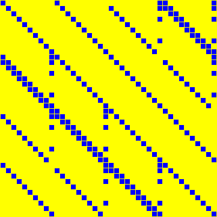 | 40 x 40 | 2026 | order = 4 | [link](https://eprint.iacr.org/2026/2520) |
| **HSWC26.C4GF10P48BN3** Huang-Sun-Wu-Chen, Circ(1,1,0x008,0x009) modulo 0x48b | 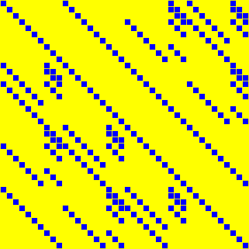 | 40 x 40 | 2026 | order = 4 | [link](https://eprint.iacr.org/2026/2520) |
| **HSWC26.C4GF10P48BN4** Huang-Sun-Wu-Chen, Circ(1,1,0x002,0x244) modulo 0x48b | 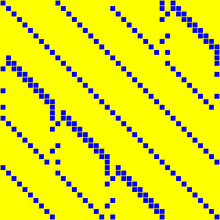 | 40 x 40 | 2026 | order = 4092 | [link](https://eprint.iacr.org/2026/2520) |
| **HSWC26.C4GF10P48BN5** Huang-Sun-Wu-Chen, Circ(1,1,0x367,0x366) modulo 0x48b | 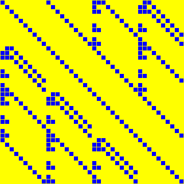 | 40 x 40 | 2026 | order = 4 | [link](https://eprint.iacr.org/2026/2520) |
| **HSWC26.C4GF12P1021N1** Huang-Sun-Wu-Chen, Circ(1,1,0x081,0x080) modulo 0x1021 | 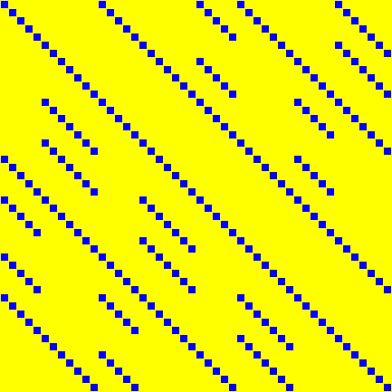 | 48 x 48 | 2026 | order = 4 | [link](https://eprint.iacr.org/2026/2520) |
| **HSWC26.C4GF12P1021N2** Huang-Sun-Wu-Chen, Circ(1,1,0x020,0x040) modulo 0x1021 | 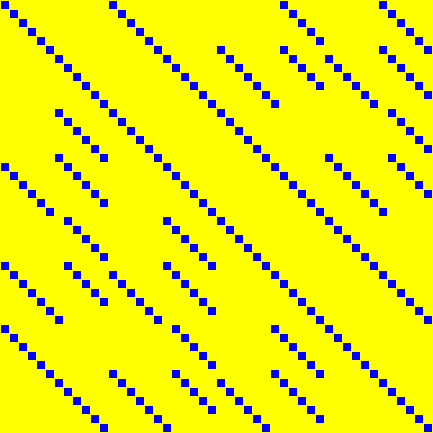 | 48 x 48 | 2026 | order = 780 | [link](https://eprint.iacr.org/2026/2520) |
| **HSWC26.C4GF12P1021N3** Huang-Sun-Wu-Chen, Circ(1,1,0x002,0x850) modulo 0x1021 | 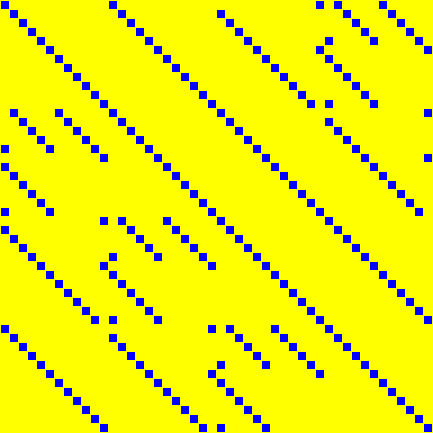 | 48 x 48 | 2026 | order = 3276 | [link](https://eprint.iacr.org/2026/2520) |
| **HSWC26.C4GF12P1021N4** Huang-Sun-Wu-Chen, Circ(1,1,0x810,0x811) modulo 0x1021 | 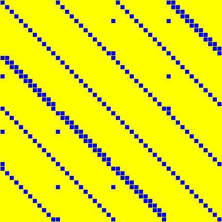 | 48 x 48 | 2026 | order = 4 | [link](https://eprint.iacr.org/2026/2520) |
| **HSWC26.C4GF12P1021N5** Huang-Sun-Wu-Chen, Circ(1,1,0x810,0x850) modulo 0x1021 | 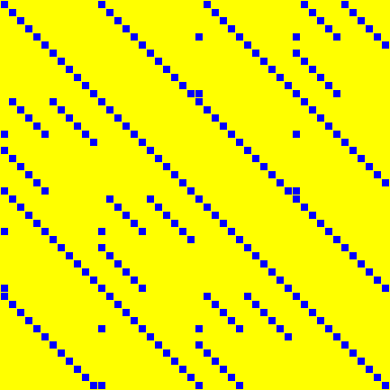 | 48 x 48 | 2026 | order = 1092 | [link](https://eprint.iacr.org/2026/2520) |
| **HSWC26.C4GF12P1183N1** Huang-Sun-Wu-Chen, Circ(1,1,0x8c1,0x8c0) modulo 0x1183 | 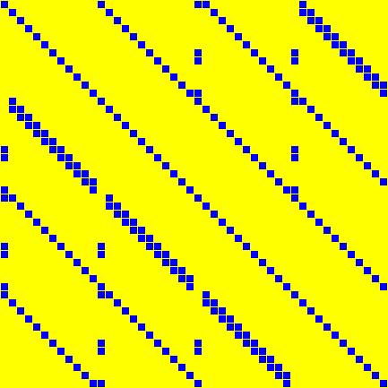 | 48 x 48 | 2026 | order = 4 | [link](https://eprint.iacr.org/2026/2520) |
| **HSWC26.C4GF12P1183N2** Huang-Sun-Wu-Chen, Circ(1,1,0x002,0x003) modulo 0x1183 | 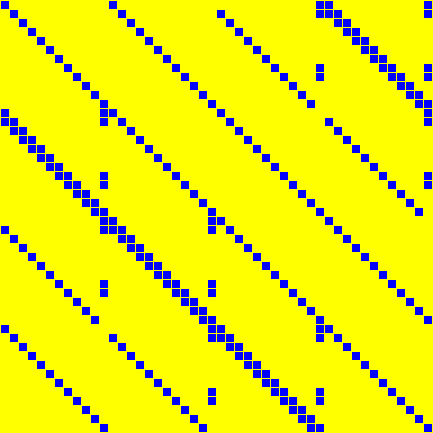 | 48 x 48 | 2026 | order = 4 | [link](https://eprint.iacr.org/2026/2520) |
| **HSWC26.C4GF12P1183N3** Huang-Sun-Wu-Chen, Circ(1,1,0x8c0,0x003) modulo 0x1183 | 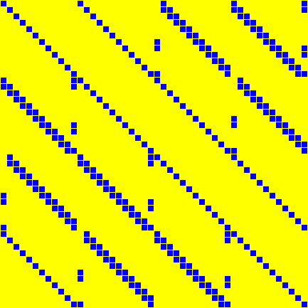 | 48 x 48 | 2026 | order = 5460 | [link](https://eprint.iacr.org/2026/2520) |
| **HSWC26.C4GF12P1183N4** Huang-Sun-Wu-Chen, Circ(1,1,0xca1,0xca0) modulo 0x1183 | 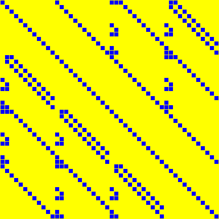 | 48 x 48 | 2026 | order = 4 | [link](https://eprint.iacr.org/2026/2520) |
| **HSWC26.C4GF12P1183N5** Huang-Sun-Wu-Chen, Circ(1,1,0x004,0x005) modulo 0x1183 | 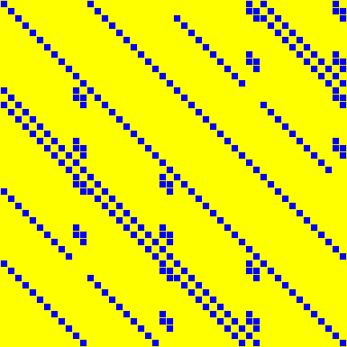 | 48 x 48 | 2026 | order = 4 | [link](https://eprint.iacr.org/2026/2520) |
| **HSWC26.C4GF16P1002DN1** Huang-Sun-Wu-Chen, Circ(1,1,0x8016,0x8017) modulo 0x1002d | 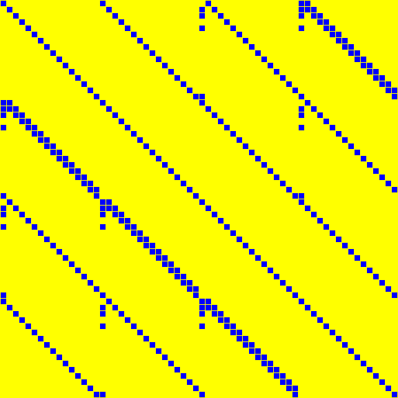 | 64 x 64 | 2026 | order = 4 | [link](https://eprint.iacr.org/2026/2520) |
| **HSWC26.C4GF16P1002DN2** Huang-Sun-Wu-Chen, Circ(1,1,0x0002,0x0003) modulo 0x1002d | 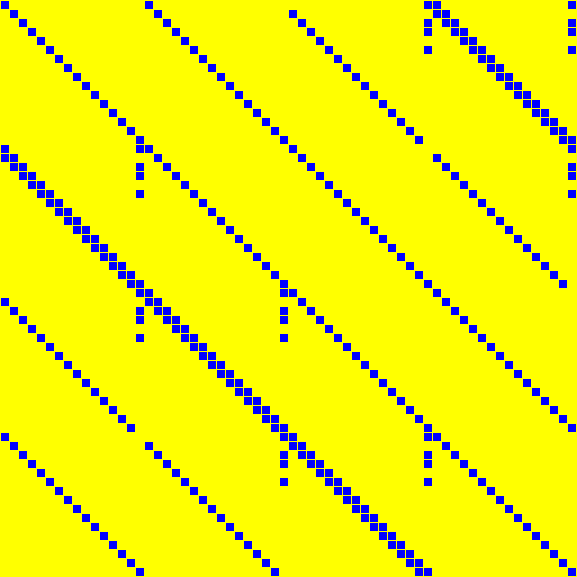 | 64 x 64 | 2026 | order = 4 | [link](https://eprint.iacr.org/2026/2520) |
| **HSWC26.C4GF16P1002DN3** Huang-Sun-Wu-Chen, Circ(1,1,0x400b,0x400a) modulo 0x1002d | 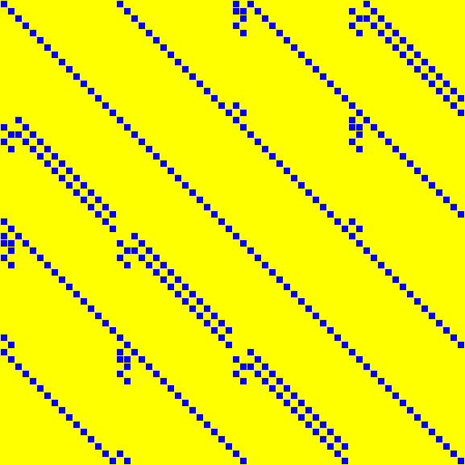 | 64 x 64 | 2026 | order = 4 | [link](https://eprint.iacr.org/2026/2520) |
| **HSWC26.C4GF16P1002DN4** Huang-Sun-Wu-Chen, Circ(1,1,0x0002,0x8014) modulo 0x1002d | 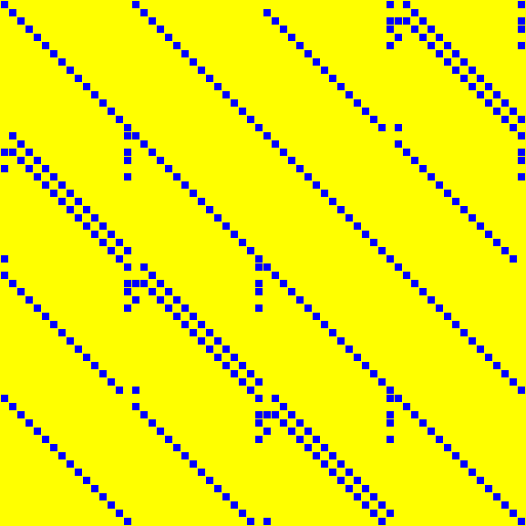 | 64 x 64 | 2026 | - | [link](https://eprint.iacr.org/2026/2520) |
| **HSWC26.C4GF16P1002DN5** Huang-Sun-Wu-Chen, Circ(1,1,0x0003,0x8017) modulo 0x1002d | 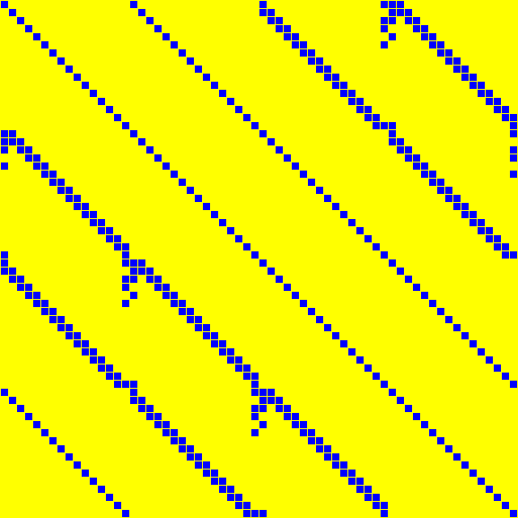 | 64 x 64 | 2026 | order = 5140 | [link](https://eprint.iacr.org/2026/2520) |
| **HSWC26.C4GF16P10129N1** Huang-Sun-Wu-Chen, Circ(1,1,0x0002,0x0003) modulo 0x10129 | 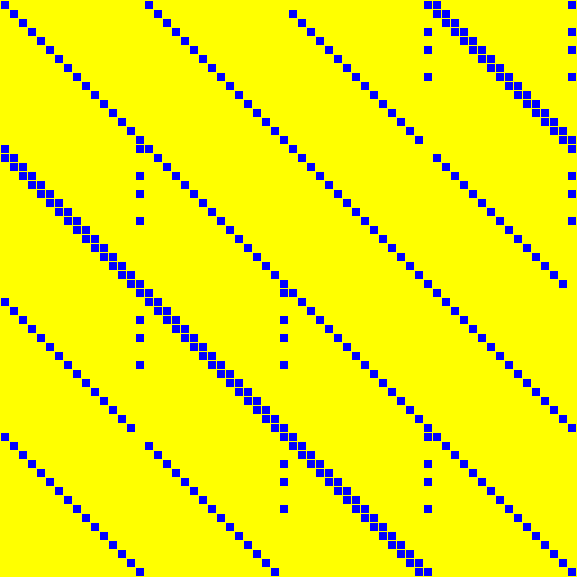 | 64 x 64 | 2026 | order = 4 | [link](https://eprint.iacr.org/2026/2520) |
| **HSWC26.C4GF16P10129N2** Huang-Sun-Wu-Chen, Circ(1,1,0x8094,0x8095) modulo 0x10129 | 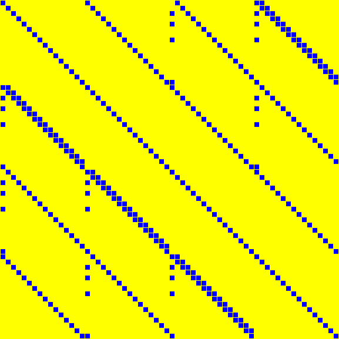 | 64 x 64 | 2026 | order = 4 | [link](https://eprint.iacr.org/2026/2520) |
| **HSWC26.C4GF16P10129N3** Huang-Sun-Wu-Chen, Circ(1,1,0x404a,0x404b) modulo 0x10129 | 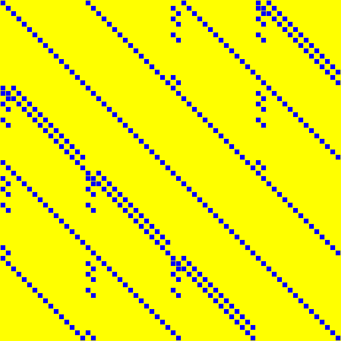 | 64 x 64 | 2026 | order = 4 | [link](https://eprint.iacr.org/2026/2520) |
| **HSWC26.C4GF16P10129N4** Huang-Sun-Wu-Chen, Circ(1,1,0x2025,0x2024) modulo 0x10129 | 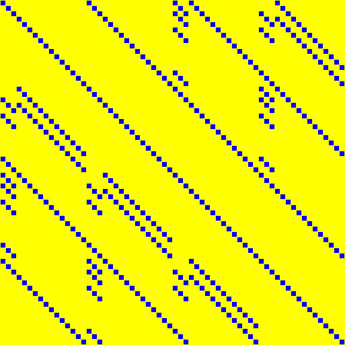 | 64 x 64 | 2026 | order = 4 | [link](https://eprint.iacr.org/2026/2520) |
| **HSWC26.C4GF16P10129N5** Huang-Sun-Wu-Chen, Circ(1,1,0x0004,0x0005) modulo 0x10129 | 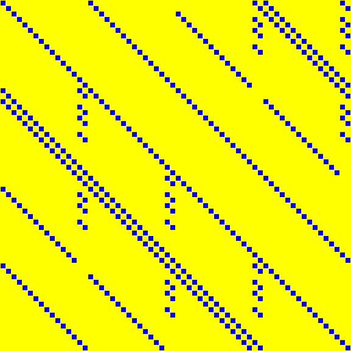 | 64 x 64 | 2026 | order = 4 | [link](https://eprint.iacr.org/2026/2520) |
| **HSWC26.C5GF8P11BN1** Huang-Sun-Wu-Chen, Circ(1,1,0x02,0xcb,0x8c) modulo 0x11b | 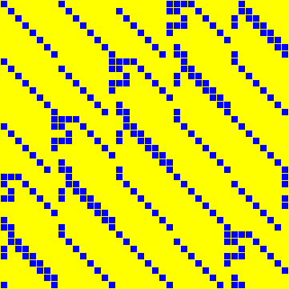 | 40 x 40 | 2026 | order = 510 | [link](https://eprint.iacr.org/2026/2520) |
| **HSWC26.C5GF8P11BN2** Huang-Sun-Wu-Chen, Circ(1,1,0x02,0xcb,0x46) modulo 0x11b | 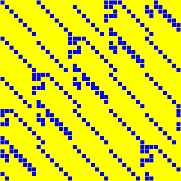 | 40 x 40 | 2026 | order = 510 | [link](https://eprint.iacr.org/2026/2520) |
| **HSWC26.C5GF8P11BN3** Huang-Sun-Wu-Chen, Circ(1,1,0x8d,0x04,0x23) modulo 0x11b | 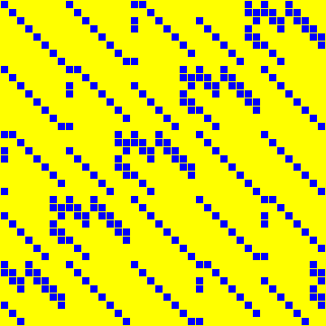 | 40 x 40 | 2026 | order = 510 | [link](https://eprint.iacr.org/2026/2520) |
| **HSWC26.C5GF8P11BN4** Huang-Sun-Wu-Chen, Circ(1,1,0x02,0xcb,0x85) modulo 0x11b | 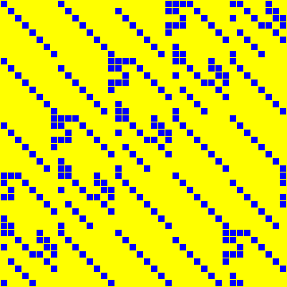 | 40 x 40 | 2026 | order = 510 | [link](https://eprint.iacr.org/2026/2520) |
| **HSWC26.C5GF8P11BN5** Huang-Sun-Wu-Chen, Circ(1,1,0x8d,0x46,0xca) modulo 0x11b | 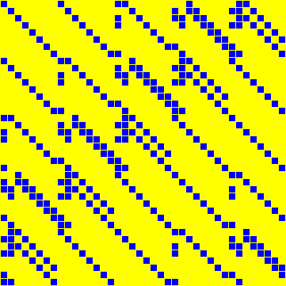 | 40 x 40 | 2026 | order = 510 | [link](https://eprint.iacr.org/2026/2520) |
| **HSWC26.C5GF8P169N1** Huang-Sun-Wu-Chen, Circ(1,1,0xb4,0x04,0x58) modulo 0x169 | 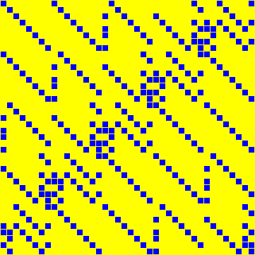 | 40 x 40 | 2026 | order = 510 | [link](https://eprint.iacr.org/2026/2520) |
| **HSWC26.C5GF8P169N2** Huang-Sun-Wu-Chen, Circ(1,1,0x02,0x5a,0xb0) modulo 0x169 | 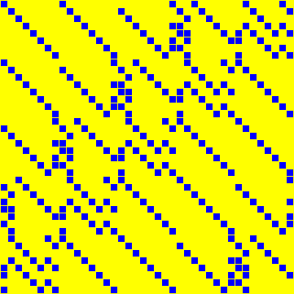 | 40 x 40 | 2026 | order = 510 | [link](https://eprint.iacr.org/2026/2520) |
| **HSWC26.C5GF8P169N3** Huang-Sun-Wu-Chen, Circ(1,1,0x02,0xa2,0xb0) modulo 0x169 | 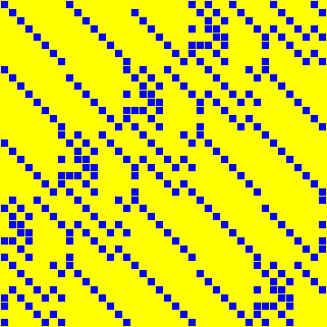 | 40 x 40 | 2026 | order = 510 | [link](https://eprint.iacr.org/2026/2520) |
| **HSWC26.C5GF8P169N4** Huang-Sun-Wu-Chen, Circ(1,1,0x02,0x05,0x08) modulo 0x169 | 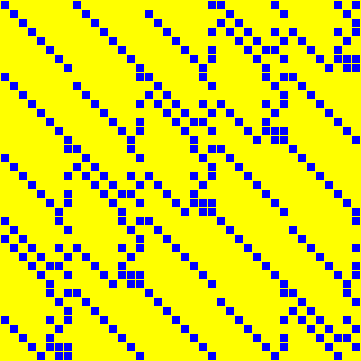 | 40 x 40 | 2026 | order = 510 | [link](https://eprint.iacr.org/2026/2520) |
| **HSWC26.C5GF8P169N5** Huang-Sun-Wu-Chen, Circ(1,1,0x02,0x03,0xb5) modulo 0x169 | 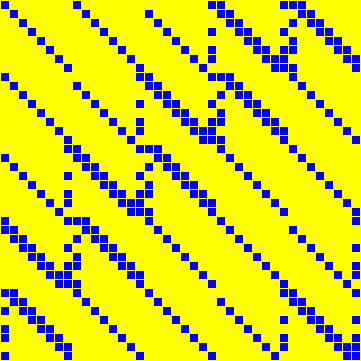 | 40 x 40 | 2026 | order = 510 | [link](https://eprint.iacr.org/2026/2520) |
| **HSWC26.C6GF8P11BN1** Huang-Sun-Wu-Chen, Circ(1,1,0x03,2,4,0xcb) modulo 0x11b | 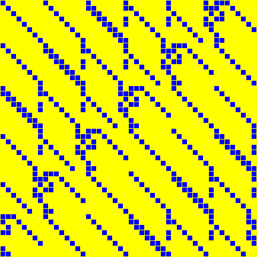 | 48 x 48 | 2026 | order = 1020 | [link](https://eprint.iacr.org/2026/2520) |
| **HSWC26.C6GF8P11BN2** Huang-Sun-Wu-Chen, Circ(1,1,0x22,2,4,0x8c) modulo 0x11b | 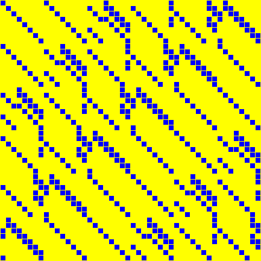 | 48 x 48 | 2026 | order = 1020 | [link](https://eprint.iacr.org/2026/2520) |
| **HSWC26.C6GF8P11BN3** Huang-Sun-Wu-Chen, Circ(1,1,0xe8,2,4,0x46) modulo 0x11b | 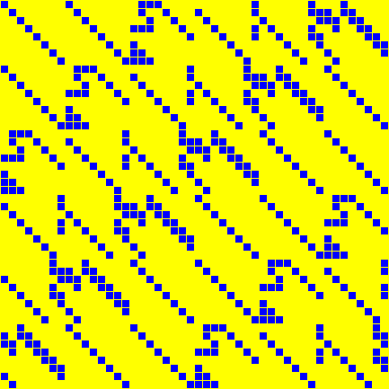 | 48 x 48 | 2026 | order = 1020 | [link](https://eprint.iacr.org/2026/2520) |
| **HSWC26.C6GF8P11BN4** Huang-Sun-Wu-Chen, Circ(1,1,0x8c,2,4,0xcb) modulo 0x11b | 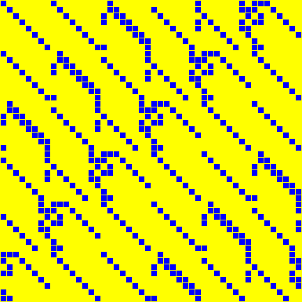 | 48 x 48 | 2026 | order = 1020 | [link](https://eprint.iacr.org/2026/2520) |
| **HSWC26.C6GF8P11BN5** Huang-Sun-Wu-Chen, Circ(1,1,0x46,2,4,0xcb) modulo 0x11b | 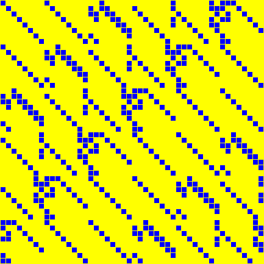 | 48 x 48 | 2026 | order = 340 | [link](https://eprint.iacr.org/2026/2520) |
| **HSWC26.C6GF8P169N1** Huang-Sun-Wu-Chen, Circ(1,1,0x03,2,4,0x5a) modulo 0x169 |  | 48 x 48 | 2026 | order = 1020 | [link](https://eprint.iacr.org/2026/2520) |
| **HSWC26.C6GF8P169N2** Huang-Sun-Wu-Chen, Circ(1,1,0x58,2,4,0xb5) modulo 0x169 |  | 48 x 48 | 2026 | order = 1020 | [link](https://eprint.iacr.org/2026/2520) |
| **HSWC26.C6GF8P169N3** Huang-Sun-Wu-Chen, Circ(1,1,0x50,2,4,0x2d) modulo 0x169 |  | 48 x 48 | 2026 | order = 1020 | [link](https://eprint.iacr.org/2026/2520) |
| **HSWC26.C6GF8P169N4** Huang-Sun-Wu-Chen, Circ(1,1,0x58,2,4,0x5a) modulo 0x169 |  | 48 x 48 | 2026 | order = 1020 | [link](https://eprint.iacr.org/2026/2520) |
| **HSWC26.C6GF8P169N5** Huang-Sun-Wu-Chen, Circ(1,1,0x2c,2,4,0xb5) modulo 0x169 |  | 48 x 48 | 2026 | order = 1020 | [link](https://eprint.iacr.org/2026/2520) |
| **HSWC26.C7GF8P11BN1** Huang-Sun-Wu-Chen, Circ(1,1,2⁻¹,1,4,0x8c,0x05) modulo 0x11b |  | 56 x 56 | 2026 | - | [link](https://eprint.iacr.org/2026/2520) |
| **HSWC26.C7GF8P11BN2** Huang-Sun-Wu-Chen, Circ(1,1,2⁻¹,1,4,0x03,0x46) modulo 0x11b |  | 56 x 56 | 2026 | - | [link](https://eprint.iacr.org/2026/2520) |
| **HSWC26.C7GF8P11BN3** Huang-Sun-Wu-Chen, Circ(1,1,2⁻¹,1,4,0x8c,0x10) modulo 0x11b |  | 56 x 56 | 2026 | - | [link](https://eprint.iacr.org/2026/2520) |
| **HSWC26.C7GF8P11BN4** Huang-Sun-Wu-Chen, Circ(1,1,2,1,4⁻¹,0x8c,0xc3) modulo 0x11b |  | 56 x 56 | 2026 | - | [link](https://eprint.iacr.org/2026/2520) |
| **HSWC26.C7GF8P11BN5** Huang-Sun-Wu-Chen, Circ(1,1,2⁻¹,1,4,0x46,0x10) modulo 0x11b |  | 56 x 56 | 2026 | - | [link](https://eprint.iacr.org/2026/2520) |
| **HSWC26.C7GF8P169N1** Huang-Sun-Wu-Chen, Circ(1,1,2⁻¹,1,4,0x03,0xb0) modulo 0x169 |  | 56 x 56 | 2026 | - | [link](https://eprint.iacr.org/2026/2520) |
| **HSWC26.C7GF8P169N2** Huang-Sun-Wu-Chen, Circ(1,1,2,1,4⁻¹,0xb5,0x09) modulo 0x169 |  | 56 x 56 | 2026 | - | [link](https://eprint.iacr.org/2026/2520) |
| **HSWC26.C7GF8P169N3** Huang-Sun-Wu-Chen, Circ(1,1,2⁻¹,1,4,0xb5,0x08) modulo 0x169 |  | 56 x 56 | 2026 | - | [link](https://eprint.iacr.org/2026/2520) |
| **HSWC26.C7GF8P169N4** Huang-Sun-Wu-Chen, Circ(1,1,2⁻¹,1,4,0xb5,0x09) modulo 0x169 |  | 56 x 56 | 2026 | - | [link](https://eprint.iacr.org/2026/2520) |
| **HSWC26.C7GF8P169N5** Huang-Sun-Wu-Chen, Circ(1,1,2⁻¹,1,4,0x03,0x58) modulo 0x169 |  | 56 x 56 | 2026 | - | [link](https://eprint.iacr.org/2026/2520) |
| **HSWC26.H4GF10P409N1** Huang-Sun-Wu-Chen, Had(1,0x081,0x020,0x024) modulo 0x409 |  | 40 x 40 | 2026 | order = 2046 | [link](https://eprint.iacr.org/2026/2520) |
| **HSWC26.H4GF10P409N2** Huang-Sun-Wu-Chen, Had(1,0x102,0x100,0x205) modulo 0x409 |  | 40 x 40 | 2026 | order = 682 | [link](https://eprint.iacr.org/2026/2520) |
| **HSWC26.H4GF10P409N3** Huang-Sun-Wu-Chen, Had(1,0x204,0x003,0x200) modulo 0x409 |  | 40 x 40 | 2026 | order = 682 | [link](https://eprint.iacr.org/2026/2520) |
| **HSWC26.H4GF10P409N4** Huang-Sun-Wu-Chen, Had(1,0x004,0x102,0x008) modulo 0x409 |  | 40 x 40 | 2026 | order = 186 | [link](https://eprint.iacr.org/2026/2520) |
| **HSWC26.H4GF10P409N5** Huang-Sun-Wu-Chen, Had(1,0x081,0x091,0x090) modulo 0x409 |  | 40 x 40 | 2026 | order = 682 | [link](https://eprint.iacr.org/2026/2520) |
| **HSWC26.H4GF10P48BN1** Huang-Sun-Wu-Chen, Had(1,0x002,0x004,0x005) modulo 0x48b |  | 40 x 40 | 2026 | order = 2046 | [link](https://eprint.iacr.org/2026/2520) |
| **HSWC26.H4GF10P48BN2** Huang-Sun-Wu-Chen, Had(1,0x004,0x003,0x005) modulo 0x48b |  | 40 x 40 | 2026 | order = 2046 | [link](https://eprint.iacr.org/2026/2520) |
| **HSWC26.H4GF10P48BN3** Huang-Sun-Wu-Chen, Had(1,0x245,0x003,0x241) modulo 0x48b |  | 40 x 40 | 2026 | order = 186 | [link](https://eprint.iacr.org/2026/2520) |
| **HSWC26.H4GF10P48BN4** Huang-Sun-Wu-Chen, Had(1,0x004,0x003,0x241) modulo 0x48b |  | 40 x 40 | 2026 | order = 2046 | [link](https://eprint.iacr.org/2026/2520) |
| **HSWC26.H4GF10P48BN5** Huang-Sun-Wu-Chen, Had(1,0x002,0x245,0x244) modulo 0x48b |  | 40 x 40 | 2026 | order = 2046 | [link](https://eprint.iacr.org/2026/2520) |
| **HSWC26.H4GF12P1021N1** Huang-Sun-Wu-Chen, Had(1,0x081,0x040,0x042) modulo 0x1021 |  | 48 x 48 | 2026 | order = 234 | [link](https://eprint.iacr.org/2026/2520) |
| **HSWC26.H4GF12P1021N2** Huang-Sun-Wu-Chen, Had(1,0x204,0x200,0x811) modulo 0x1021 |  | 48 x 48 | 2026 | order = 1638 | [link](https://eprint.iacr.org/2026/2520) |
| **HSWC26.H4GF12P1021N3** Huang-Sun-Wu-Chen, Had(1,0x810,0x003,0x814) modulo 0x1021 |  | 48 x 48 | 2026 | order = 8190 | [link](https://eprint.iacr.org/2026/2520) |
| **HSWC26.H4GF12P1021N4** Huang-Sun-Wu-Chen, Had(1,0x002,0x811,0x40a) modulo 0x1021 |  | 48 x 48 | 2026 | order = 1170 | [link](https://eprint.iacr.org/2026/2520) |
| **HSWC26.H4GF12P1021N5** Huang-Sun-Wu-Chen, Had(1,0x408,0x003,0x400) modulo 0x1021 |  | 48 x 48 | 2026 | order = 2730 | [link](https://eprint.iacr.org/2026/2520) |
| **HSWC26.H4GF12P1183N1** Huang-Sun-Wu-Chen, Had(1,0x002,0x8c1,0x8c0) modulo 0x1183 |  | 48 x 48 | 2026 | order = 910 | [link](https://eprint.iacr.org/2026/2520) |
| **HSWC26.H4GF12P1183N2** Huang-Sun-Wu-Chen, Had(1,0x002,0x8c1,0x003) modulo 0x1183 |  | 48 x 48 | 2026 | order = 910 | [link](https://eprint.iacr.org/2026/2520) |
| **HSWC26.H4GF12P1183N3** Huang-Sun-Wu-Chen, Had(1,0x8c1,0x010,0x011) modulo 0x1183 |  | 48 x 48 | 2026 | order = 910 | [link](https://eprint.iacr.org/2026/2520) |
| **HSWC26.H4GF12P1183N4** Huang-Sun-Wu-Chen, Had(1,0x002,0x8c1,0x460) modulo 0x1183 |  | 48 x 48 | 2026 | order = 1170 | [link](https://eprint.iacr.org/2026/2520) |
| **HSWC26.H4GF12P1183N5** Huang-Sun-Wu-Chen, Had(1,0x8c1,0x008,0x8c0) modulo 0x1183 |  | 48 x 48 | 2026 | order = 910 | [link](https://eprint.iacr.org/2026/2520) |
| **HSWC26.H4GF16P1002DN1** Huang-Sun-Wu-Chen, Had(1,0x400b,0xa013,0x2005) modulo 0x1002d |  | 64 x 64 | 2026 | order = 131070 | [link](https://eprint.iacr.org/2026/2520) |
| **HSWC26.H4GF16P1002DN2** Huang-Sun-Wu-Chen, Had(1,0x0002,0x0004,0x0005) modulo 0x1002d |  | 64 x 64 | 2026 | order = 131070 | [link](https://eprint.iacr.org/2026/2520) |
| **HSWC26.H4GF16P1002DN3** Huang-Sun-Wu-Chen, Had(1,0x8016,0x400b,0x400a) modulo 0x1002d |  | 64 x 64 | 2026 | order = 131070 | [link](https://eprint.iacr.org/2026/2520) |
| **HSWC26.H4GF16P1002DN4** Huang-Sun-Wu-Chen, Had(1,0x0002,0x8016,0x0003) modulo 0x1002d |  | 64 x 64 | 2026 | order = 131070 | [link](https://eprint.iacr.org/2026/2520) |
| **HSWC26.H4GF16P1002DN5** Huang-Sun-Wu-Chen, Had(1,0x8016,0x8017,0x2005) modulo 0x1002d |  | 64 x 64 | 2026 | order = 131070 | [link](https://eprint.iacr.org/2026/2520) |
| **HSWC26.H4GF16P10129N1** Huang-Sun-Wu-Chen, Had(1,0x404a,0x8095,0x4048) modulo 0x10129 |  | 64 x 64 | 2026 | order = 7710 | [link](https://eprint.iacr.org/2026/2520) |
| **HSWC26.H4GF16P10129N2** Huang-Sun-Wu-Chen, Had(1,0x8094,0x0003,0x8090) modulo 0x10129 |  | 64 x 64 | 2026 | order = 26214 | [link](https://eprint.iacr.org/2026/2520) |
| **HSWC26.H4GF16P10129N3** Huang-Sun-Wu-Chen, Had(1,0x0002,0x8095,0x4048) modulo 0x10129 |  | 64 x 64 | 2026 | order = 131070 | [link](https://eprint.iacr.org/2026/2520) |
| **HSWC26.H4GF16P10129N4** Huang-Sun-Wu-Chen, Had(1,0x8094,0x404a,0x404b) modulo 0x10129 |  | 64 x 64 | 2026 | order = 43690 | [link](https://eprint.iacr.org/2026/2520) |
| **HSWC26.H4GF16P10129N5** Huang-Sun-Wu-Chen, Had(1,0x0002,0x0004,0x0005) modulo 0x10129 |  | 64 x 64 | 2026 | order = 43690 | [link](https://eprint.iacr.org/2026/2520) |
| **HSWC26.IH4GF10P409N1** Huang-Sun-Wu-Chen, Had(1,0x008,0x081,0x089) modulo 0x409 |  | 40 x 40 | 2026 | involution, order = 2 | [link](https://eprint.iacr.org/2026/2520) |
| **HSWC26.IH4GF10P409N2** Huang-Sun-Wu-Chen, Had(1,0x008,0x040,0x048) modulo 0x409 |  | 40 x 40 | 2026 | involution, order = 2 | [link](https://eprint.iacr.org/2026/2520) |
| **HSWC26.IH4GF10P409N3** Huang-Sun-Wu-Chen, Had(1,0x002,0x204,0x206) modulo 0x409 |  | 40 x 40 | 2026 | involution, order = 2 | [link](https://eprint.iacr.org/2026/2520) |
| **HSWC26.IH4GF10P409N4** Huang-Sun-Wu-Chen, Had(1,0x102,0x020,0x122) modulo 0x409 |  | 40 x 40 | 2026 | involution, order = 2 | [link](https://eprint.iacr.org/2026/2520) |
| **HSWC26.IH4GF10P409N5** Huang-Sun-Wu-Chen, Had(1,0x002,0x102,0x100) modulo 0x409 |  | 40 x 40 | 2026 | involution, order = 2 | [link](https://eprint.iacr.org/2026/2520) |
| **HSWC26.IH4GF10P48BN1** Huang-Sun-Wu-Chen, Had(1,0x002,0x245,0x247) modulo 0x48b |  | 40 x 40 | 2026 | involution, order = 2 | [link](https://eprint.iacr.org/2026/2520) |
| **HSWC26.IH4GF10P48BN2** Huang-Sun-Wu-Chen, Had(1,0x245,0x367,0x122) modulo 0x48b |  | 40 x 40 | 2026 | involution, order = 2 | [link](https://eprint.iacr.org/2026/2520) |
| **HSWC26.IH4GF10P48BN3** Huang-Sun-Wu-Chen, Had(1,0x245,0x004,0x241) modulo 0x48b |  | 40 x 40 | 2026 | involution, order = 2 | [link](https://eprint.iacr.org/2026/2520) |
| **HSWC26.IH4GF10P48BN4** Huang-Sun-Wu-Chen, Had(1,0x002,0x367,0x365) modulo 0x48b |  | 40 x 40 | 2026 | involution, order = 2 | [link](https://eprint.iacr.org/2026/2520) |
| **HSWC26.IH4GF10P48BN5** Huang-Sun-Wu-Chen, Had(1,0x002,0x010,0x012) modulo 0x48b |  | 40 x 40 | 2026 | involution, order = 2 | [link](https://eprint.iacr.org/2026/2520) |
| **HSWC26.IH4GF12P1021N1** Huang-Sun-Wu-Chen, Had(1,0x002,0x810,0x812) modulo 0x1021 |  | 48 x 48 | 2026 | involution, order = 2 | [link](https://eprint.iacr.org/2026/2520) |
| **HSWC26.IH4GF12P1021N2** Huang-Sun-Wu-Chen, Had(1,0x810,0x040,0x850) modulo 0x1021 |  | 48 x 48 | 2026 | involution, order = 2 | [link](https://eprint.iacr.org/2026/2520) |
| **HSWC26.IH4GF12P1021N3** Huang-Sun-Wu-Chen, Had(1,0x002,0x102,0x100) modulo 0x1021 |  | 48 x 48 | 2026 | involution, order = 2 | [link](https://eprint.iacr.org/2026/2520) |
| **HSWC26.IH4GF12P1021N4** Huang-Sun-Wu-Chen, Had(1,0x004,0x408,0x40c) modulo 0x1021 |  | 48 x 48 | 2026 | involution, order = 2 | [link](https://eprint.iacr.org/2026/2520) |
| **HSWC26.IH4GF12P1021N5** Huang-Sun-Wu-Chen, Had(1,0x004,0x204,0x200) modulo 0x1021 |  | 48 x 48 | 2026 | involution, order = 2 | [link](https://eprint.iacr.org/2026/2520) |
| **HSWC26.IH4GF12P1183N1** Huang-Sun-Wu-Chen, Had(1,0x002,0x8c1,0x8c3) modulo 0x1183 |  | 48 x 48 | 2026 | involution, order = 2 | [link](https://eprint.iacr.org/2026/2520) |
| **HSWC26.IH4GF12P1183N2** Huang-Sun-Wu-Chen, Had(1,0x8c1,0xca1,0x460) modulo 0x1183 |  | 48 x 48 | 2026 | involution, order = 2 | [link](https://eprint.iacr.org/2026/2520) |
| **HSWC26.IH4GF12P1183N3** Huang-Sun-Wu-Chen, Had(1,0x002,0x004,0x006) modulo 0x1183 |  | 48 x 48 | 2026 | involution, order = 2 | [link](https://eprint.iacr.org/2026/2520) |
| **HSWC26.IH4GF12P1183N4** Huang-Sun-Wu-Chen, Had(1,0xca1,0xe91,0x230) modulo 0x1183 |  | 48 x 48 | 2026 | involution, order = 2 | [link](https://eprint.iacr.org/2026/2520) |
| **HSWC26.IH4GF12P1183N5** Huang-Sun-Wu-Chen, Had(1,0x002,0x022,0x020) modulo 0x1183 |  | 48 x 48 | 2026 | involution, order = 2 | [link](https://eprint.iacr.org/2026/2520) |
| **HSWC26.IH4GF16P1002DN1** Huang-Sun-Wu-Chen, Had(1,0x0002,0x8016,0x8014) modulo 0x1002d |  | 64 x 64 | 2026 | involution, order = 2 | [link](https://eprint.iacr.org/2026/2520) |
| **HSWC26.IH4GF16P1002DN2** Huang-Sun-Wu-Chen, Had(1,0x0002,0x0004,0x0006) modulo 0x1002d |  | 64 x 64 | 2026 | involution, order = 2 | [link](https://eprint.iacr.org/2026/2520) |
| **HSWC26.IH4GF16P1002DN3** Huang-Sun-Wu-Chen, Had(1,0x8016,0x400b,0xc01d) modulo 0x1002d |  | 64 x 64 | 2026 | involution, order = 2 | [link](https://eprint.iacr.org/2026/2520) |
| **HSWC26.IH4GF16P1002DN4** Huang-Sun-Wu-Chen, Had(1,0x8016,0xa013,0x2005) modulo 0x1002d |  | 64 x 64 | 2026 | involution, order = 2 | [link](https://eprint.iacr.org/2026/2520) |
| **HSWC26.IH4GF16P1002DN5** Huang-Sun-Wu-Chen, Had(1,0x0002,0x400b,0x4009) modulo 0x1002d |  | 64 x 64 | 2026 | involution, order = 2 | [link](https://eprint.iacr.org/2026/2520) |
| **HSWC26.IH4GF16P10129N1** Huang-Sun-Wu-Chen, Had(1,0x0002,0x8094,0x8096) modulo 0x10129 |  | 64 x 64 | 2026 | involution, order = 2 | [link](https://eprint.iacr.org/2026/2520) |
| **HSWC26.IH4GF16P10129N2** Huang-Sun-Wu-Chen, Had(1,0x0002,0x0004,0x0006) modulo 0x10129 |  | 64 x 64 | 2026 | involution, order = 2 | [link](https://eprint.iacr.org/2026/2520) |
| **HSWC26.IH4GF16P10129N3** Huang-Sun-Wu-Chen, Had(1,0x8094,0x404a,0xc0de) modulo 0x10129 |  | 64 x 64 | 2026 | involution, order = 2 | [link](https://eprint.iacr.org/2026/2520) |
| **HSWC26.IH4GF16P10129N4** Huang-Sun-Wu-Chen, Had(1,0x0002,0x404a,0x4048) modulo 0x10129 |  | 64 x 64 | 2026 | involution, order = 2 | [link](https://eprint.iacr.org/2026/2520) |
| **HSWC26.IH4GF16P10129N5** Huang-Sun-Wu-Chen, Had(1,0x8094,0x0004,0x8090) modulo 0x10129 |  | 64 x 64 | 2026 | involution, order = 2 | [link](https://eprint.iacr.org/2026/2520) |
| **JPST17.IS64** Jean-Peyrin-Sim-Tourteaux, involutory 8 × 8 over GF(2⁸) |  | 64 x 64 | 2017 | order = 170 | [link](https://eprint.iacr.org/2017/101) |
| **KECCAK.50** Keccak-f[50], θ |  | 50 x 50 | 2015 | order = 6 | [link](https://nvlpubs.nist.gov/nistpubs/FIPS/NIST.FIPS.202.pdf) |
| **KHAZAD.H** KHAZAD, H also known as `KHAZAD` |  | 64 x 64 | 2000 | involution, order = 2 | [link](https://www.cosic.esat.kuleuven.be/nessie/) |
| **KLEIN.MIXNIBBLES** KLEIN, MixNibbles |  | 64 x 64 | 2011 | order = 4 | [link](https://doi.org/10.1007/978-3-642-25286-0_1) |
| **KLSW17.IS64** Kranz-Leander-Stoffelen-Wiemer, M⁻¹, 8 × 8 over GF(2⁸) |  | 64 x 64 | 2017 | involution, order = 2 | [link](https://tosc.iacr.org/index.php/ToSC/article/view/805) |
| **KLSW17.S64** Kranz-Leander-Stoffelen-Wiemer, M, 8 × 8 over GF(2⁸) |  | 64 x 64 | 2017 | - | [link](https://tosc.iacr.org/index.php/ToSC/article/view/805) |
| **LS16.S64** Liu-Sim, 8 × 8 over GF(2⁸) |  | 64 x 64 | 2016 | order = 2040 | [link](https://tosc.iacr.org/index.php/ToSC) |
| **PHOTON.P288** PHOTON, P₂₈₈ |  | 48 x 48 | 2011 | - | [link](https://doi.org/10.1007/978-3-642-22792-9_13) |
| **PRINCE.MPRIME** PRINCE, M′ |  | 64 x 64 | 2012 | involution, symmetric, order = 2 | [link](https://eprint.iacr.org/2012/529) |
| **SCARF.SIGMA** SCARF, Σ |  | 60 x 60 | 2023 | order = 60 | [link](https://www.usenix.org/conference/usenixsecurity23/presentation/canale) |
| **SHA512.BIGSIGMA0** SHA-512, Σ₀ |  | 64 x 64 | 2015 | order = 64 | [link](https://nvlpubs.nist.gov/nistpubs/FIPS/NIST.FIPS.180-4.pdf) |
| **SHA512.BIGSIGMA1** SHA-512, Σ₁ |  | 64 x 64 | 2015 | order = 64 | [link](https://nvlpubs.nist.gov/nistpubs/FIPS/NIST.FIPS.180-4.pdf) |
| **SHA512.SMALLSIGMA0** SHA-512, σ₀ |  | 64 x 64 | 2015 | - | [link](https://nvlpubs.nist.gov/nistpubs/FIPS/NIST.FIPS.180-4.pdf) |
| **SHA512.SMALLSIGMA1** SHA-512, σ₁ |  | 64 x 64 | 2015 | - | [link](https://nvlpubs.nist.gov/nistpubs/FIPS/NIST.FIPS.180-4.pdf) |
| **SKOP15.IS64** Sim-Khoo-Oggier-Peyrin, involutory 8 × 8 over GF(2⁸) |  | 64 x 64 | 2015 | involution, order = 2 | [link](https://tosc.iacr.org/) |
| **SKOP15.S64** Sim-Khoo-Oggier-Peyrin, 8 × 8 over GF(2⁸) |  | 64 x 64 | 2015 | order = 510 | [link](https://eprint.iacr.org/2015/258) |
| **SPARX.L2** SPARX, L₂ |  | 64 x 64 | 2016 | symmetric, order = 6 | [link](https://eprint.iacr.org/2016/984.pdf) |
| **SPOOK.LBOX** Spook, Clyde-128 L′ also known as `CLYDE.LBOX` |  | 64 x 64 | 2020 | order = 32 | [link](https://tosc.iacr.org/index.php/ToSC/article/view/8623) |
| **SS17.S64** Sarkar-Syed, 8 × 8 over GF(2⁸) also known as `ACISP_SarSye17_8x8_4`, `ACISP_SarSye17_8x8_8` |  | 64 x 64 | 2017 | order = 2040 | [link](https://eprint.iacr.org/2017/368) |
| **UKNIT.L0** uKNIT-BC, L₀ |  | 64 x 64 | 2025 | - | [link](https://tosc.iacr.org/index.php/ToSC/article/view/13006) |
| **UKNIT.L1** uKNIT-BC, L₁ |  | 64 x 64 | 2025 | - | [link](https://tosc.iacr.org/index.php/ToSC/article/view/13006) |
| **UKNIT.L10** uKNIT-BC, L₁₀ |  | 64 x 64 | 2025 | - | [link](https://tosc.iacr.org/index.php/ToSC/article/view/13006) |
| **UKNIT.L2** uKNIT-BC, L₂ |  | 64 x 64 | 2025 | - | [link](https://tosc.iacr.org/index.php/ToSC/article/view/13006) |
| **UKNIT.L3** uKNIT-BC, L₃ |  | 64 x 64 | 2025 | - | [link](https://tosc.iacr.org/index.php/ToSC/article/view/13006) |
| **UKNIT.L4** uKNIT-BC, L₄ |  | 64 x 64 | 2025 | - | [link](https://tosc.iacr.org/index.php/ToSC/article/view/13006) |
| **UKNIT.L5** uKNIT-BC, L₅ |  | 64 x 64 | 2025 | - | [link](https://tosc.iacr.org/index.php/ToSC/article/view/13006) |
| **UKNIT.L6** uKNIT-BC, L₆ |  | 64 x 64 | 2025 | - | [link](https://tosc.iacr.org/index.php/ToSC/article/view/13006) |
| **UKNIT.L7** uKNIT-BC, L₇ |  | 64 x 64 | 2025 | - | [link](https://tosc.iacr.org/index.php/ToSC/article/view/13006) |
| **UKNIT.L8** uKNIT-BC, L₈ |  | 64 x 64 | 2025 | - | [link](https://tosc.iacr.org/index.php/ToSC/article/view/13006) |
| **UKNIT.L9** uKNIT-BC, L₉ |  | 64 x 64 | 2025 | - | [link](https://tosc.iacr.org/index.php/ToSC/article/view/13006) |
| **WHIRLPOOL.MIXROW** Whirlpool, MixRows also known as `WHIRLPOOL` |  | 64 x 64 | 2000 | order = 408 | [link](https://web.archive.org/web/20171129084214/http://www.larc.usp.br/~pbarreto/WhirlpoolPage.html) |

